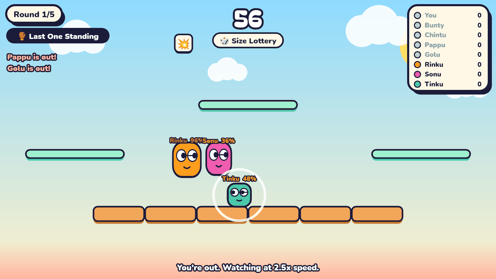

# 🎮 Mutator Party

<div align="center">



**An authoritative multiplayer 2D platform brawler with chaotic per-round rule twists.**  
*2 to 12 players per room • 60-second rounds • Zero-lag authoritative simulation • Infinite variety*

[](https://www.typescriptlang.org/)
[](https://nodejs.org/)
[](https://colyseus.io/)
[](https://vitest.dev/)
[](https://pnpm.io/)
[](https://opensource.org/licenses/ISC)

[Features](#-game-features) • [Architecture](#-architecture) • [Getting Started](#-getting-started) • [Sim Engine](#-deterministic-simulation-engine) • [Roadmap](#-roadmap)

</div>

---

## 🕹️ What is Mutator Party?

**Mutator Party** is a fast-paced, browser-based party brawler built for quick-fire multiplayer battles with friends or bots. Players join private rooms via simple 5-character room codes. Each match consists of 5 frantic rounds where **modes**, **procedural arenas**, and **game-altering rule twists** stack to create hilarious emergent gameplay.

Between rounds, the trailing player (or group vote) picks the next round's twist, ensuring intense comebacks and unpredictable matches!

---

## ✨ Game Features

### 🥊 3 Core Game Modes
- **Last One Standing (Brawl)**: Classic knockout ring-out. Shove opponents off the island; surviving players score placement points.
- **Bomb Tag**: Hot potato with an expanding fuse (`4 + 0.6 × alive` seconds). Shove rivals to pass the bomb before it detonates!
- **Crown Rush**: Hold the golden crown to accumulate possession points (`1 pt/sec`). Shove the carrier to steal it, with a 1.0s grace protection buffer for the victim.

### 🌀 13 Game-Changing Rule Twists
Twists modify physics, controls, and environments under a strict **category exclusion rule** (no two twists from the same category):
- **Gravity (`g`)**: `Moon Gravity` (low gravity ×0.33, high hops) • `Heavy Boots` (heavy gravity ×1.7, hard landings).
- **Scale (`s`)**: `Tiny Fighters` (scale 0.55) • `Giant Brawlers` (scale 1.7) • `Lotto Scale` (randomized 0.5–1.8 per player).
- **Controls (`c`)**: `Reverse Controls` (left/right inverted) • `Ice Arena` (low grip, heavy sliding) • `Turbo Speed` (top speed ×1.55).
- **Jumping (`j`)**: `Flappy Party` (unlimited air jumps).
- **World (`w`)**: `Crumbling Island` (floor tiles break away) • `Crosswinds` (shifting 170 px/s wind) • `Lights Out` (restricted visibility) • `Trampoline Land` (bouncy surfaces).

### 🎁 4 Power-Up Items
Power spots spawn crates around the map under a **first-touch** claim mechanic:
- 💥 **Mega Shove**: ×2.6 knockback force, ×1.5 range.
- 🧊 **Freeze Burst**: 170 px area-of-effect freeze for 1.4s.
- 🔀 **Position Swap**: Instantly swap positions with the nearest rival.
- 🛡️ **Shield**: 5-second invulnerability to knockbacks, freezes, and bomb passes.

### 🎨 7 Vibrant Themes
`Sunny Day` • `Neon Arcade` • `Candy Land` • `Frozen Tundra` • `Desert Oasis` • `Deep Space` • `Diwali Festive` — complete with curated color palettes and linked twist affinities.

---

## 🏗️ Architecture

The repository is organized as a high-performance **pnpm monorepo**:

```text
mutator-party/
├── packages/
│   └── shared/          # Pure TypeScript game rules & deterministic physics engine
│       ├── src/
│       │   ├── constants.ts   # Tunable physics & combat constants
│       │   ├── rng.ts         # Mulberry32 PRNG & FNV-1a seeded hash streams
│       │   ├── arena.ts       # Procedural reachable arena generator (BFS validated)
│       │   ├── settings.ts    # Zod schema with auto-clamping & sanitizer
│       │   ├── input.ts       # 4-bit bitmask pack/unpack & RFC 1982 wrap-safe seq
│       │   ├── theme.ts       # Theme palettes & linked twist definitions
│       │   ├── types.ts       # State models (SimState, PlayerState, Events)
│       │   └── sim/           # 30 Hz fixed-step simulation engine
│       │       ├── step.ts      # Pure step(state, inputs, dt) loop
│       │       ├── movement.ts  # Gravity, run, jump, coyote time, jump buffer
│       │       ├── platforms.ts # One-way floating & floor island collisions
│       │       └── shove.ts     # Range, combat knockback, and hit-scaling
│       └── test/              # Vitest unit & determinism test suites
├── apps/
│   ├── server/          # Authoritative game server (Colyseus 0.17 + Node 20)
│   └── client/          # Frontend client (Phaser + Preact HUD)
├── docs/                # Architecture diagrams, backend & frontend specs
├── PROGRESS.md          # Real-time roadmap & milestone tracking
└── GAPS_AND_FIXES.md    # Senior engineer audit notes & resolution checklist
```

### ⚡ Architectural Principles
1. **Zero External Dependencies in Shared**: [`packages/shared`](./packages/shared) imports no Node, Phaser, or Colyseus APIs. It compiles to clean ES modules used by both server and client.
2. **Pure Deterministic Simulation**: `step(state, inputs, dt)` is 100% deterministic with zero `Date.now()` or `Math.random()` calls. Randomness strictly derives from seeded PRNG streams.
3. **Client Prediction Ready**: Because the simulation is a pure function, clients can run the exact same simulation locally for instant client-side prediction and server reconciliation.
4. **Host-Controlled & Server-Authoritative**: Clients send only compact 4-bit input bitfields; the server simulates all positions, knockbacks, scores, and eliminations.

---

## 🚀 Getting Started

### Prerequisites
- **Node.js**: `v20.0.0` or newer
- **pnpm**: `v10.0.0` or newer

### Installation

```bash
# Clone the repository
git clone https://github.com/SATYAPRAKASH1419/mutator_party.git
cd mutator-party

# Install all workspace dependencies
pnpm install
```

### Running Tests

The test suite runs with **Vitest** across all packages:

```bash
# Run all tests in the workspace
pnpm test
```

Current test status:
- ✅ `test/rng.test.ts` (5 tests) — PRNG determinism & seeded shuffle
- ✅ `test/arena.test.ts` (5 tests) — Procedural generation & reachability
- ✅ `test/input.test.ts` (7 tests) — Bitmask encoding & sequence comparison
- ✅ `test/settings.test.ts` (5 tests) — Zod schema validation & hostile clamping
- ✅ `test/sim.test.ts` (9 tests) — Determinism gate (60s identical hashes), jump physics, shove scaling, kill zones, performance benchmarks

### Building

```bash
# Build all packages via TypeScript
pnpm build
```

---

## 🧮 Deterministic Simulation Engine

The fixed-step engine runs at **30 Hz** (`dt = 1/30s = 0.0333s`):

| Parameter | Value | Details |
|---|---|---|
| **Gravity** | `1800 px/s²` | Smooth, responsive gravity |
| **Run Speed** | `420 px/s` | Acceleration: `2800 px/s²`, Braking: `2400 px/s²` |
| **Jump Velocity** | `720 px/s` | Apex height: `~144 px` |
| **Air Jump** | `×0.88` multiplier | Apex addition: `~111 px` |
| **Coyote Time** | `0.09 s` | Forgiving ledge jump window |
| **Jump Buffer** | `0.12 s` | Pre-landing jump registration |
| **Shove Cooldown** | `0.85 s` | Range: `62 px × scale + targetHalf` |
| **Knockback Force** | `(620 + 70 × hits) × √(scaleRatio)` | Scales with accumulated hits |
| **Pop-up Kick** | `260 px/s` | Extra vertical lift on shove |
| **Kill Zones** | `y > 630`, `x < -90`, `x > 1050` | Out-of-bounds elimination |

---

## 🗺️ Roadmap & Current Status

Track real-time implementation milestones in [`PROGRESS.md`](./PROGRESS.md):

- [x] **Step 1: Monorepo & Shared Foundation** — Constants, RNG, Procedural Arena, Settings Schema, Input Encoding.
- [x] **Step 2: Fixed-Step Simulation** — Pure 30 Hz simulation, player movement, jump/air-jump, combat shoves, platform collision, and determinism gate.
- [ ] **Step 3: Server Skeleton** — Colyseus 0.17 server, room code generation (`ABCDEFGHJKMNPQRSTUVWXYZ23456789`), lobby state synchronization, join validation.
- [ ] **Step 4: Match Flow & Phase Controller** — Phase state machine (`lobby` → `intro` → `pick` → `play` → `results` → `final`), twist selection, round seeding.
- [ ] **Step 5: Modes, Twists & Items** — Mode rule implementations (`brawl`, `bomb`, `crown`), 13 twists, power-up pickup logic.
- [ ] **Step 6: Bots, Reconnection & AFK** — AI player takeover on disconnect, 30s reconnect window, AFK detection.
- [ ] **Step 7: Observability & Hardening** — Rate limiting, Pino structured logging, `/metrics` endpoint.
- [ ] **Step 8: Tuning & Capacity Benchmarks** — 100 rooms/vCPU validation.
- [ ] **Client: Phaser 4 Frontend** — Client prediction, Preact HUD, touch controls, sound synthesis.

---

## 📜 License

This project is licensed under the **ISC License**.
