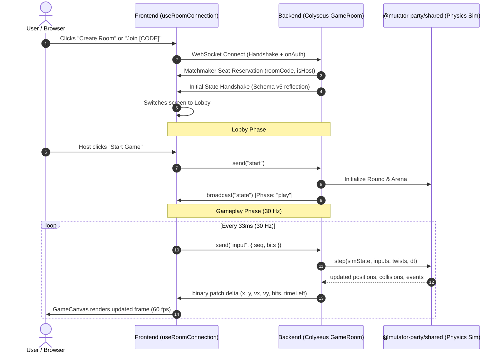

# Mutator Party: Frontend ↔ Backend Connection Architecture Guide

> **A Complete, Step-by-Step Guide for Understanding How the Client and Server Communicate**  
> *Target Audience: Developers, Architects, and New Contributors*

---

## 1. High-Level Architecture Overview

Mutator Party is built on an **Authoritative Server** multiplayer architecture using WebSockets via **Colyseus 0.18**. 

- **The Backend (Server)** is the single source of truth for all game rules, player positions, collision physics, health, scoring, rounds, and twists.
- **The Frontend (Client)** is an input collector and visual renderer: it samples user controls at 30 Hz, sends lightweight 4-bit action masks to the server, and renders the server's state snapshots using Canvas 2D and Preact DOM.



---

## 2. The Abstraction Contract: `RoomConnection`

To ensure clean modularity and allow seamless testing, the frontend **never talks directly to Colyseus in the UI layer**. Everything sits behind a standard TypeScript interface:

📁 **[`apps/client/src/net/connection.ts`](file:///c:/Users/satya/Desktop/mutator-party/apps/client/src/net/connection.ts)**

```typescript
export interface RoomConnection {
  // 1. Establish connection to a room
  connect(opts: ConnectOptions): Promise<JoinResult>;

  // 2. Client-to-Server dispatchers
  send: {
    input(seq: number, bits: number): void;
    settingsUpdate(patch: Partial<RoomSettings>): void;
    ready(value: boolean): void;
    start(): void;
    pick(index: 0 | 1 | 2): void;
    emote(id: string): void;
    kick(playerId: string): void;
    rematch(): void;
    nextRound(): void;
  };

  // 3. Server-to-Client event listeners
  on(evt: "state", cb: (s: RoomClientState) => void): () => void;
  on(evt: "settings", cb: (s: Partial<RoomSettings>) => void): () => void;
  on(evt: "roundStart", cb: (r: any) => void): () => void;
  on(evt: "event", cb: (e: { type: string; payload?: any }) => void): () => void;
  on(evt: "error", cb: (e: { code: string; message: string }) => void): () => void;
  on(evt: "status", cb: (s: ConnectionStatus) => void): () => void;
  on(evt: "pickOffer", cb: (offer: any) => void): () => void;
  on(evt: "emote", cb: (e: { playerId: string; id: string }) => void): () => void;
  on(evt: "roomInfo", cb: (info: { code: string; isHost: boolean }) => void): () => void;

  // 4. Leave / Disconnect
  leave(): void;
}
```

There are two interchangeable implementations of this interface:
1. **`ColyseusRoomConnection`** (`apps/client/src/net/colyseusConnection.ts`): Talks to the real Node.js backend at `ws://localhost:2567`.
2. **`MockRoomConnection`** (`apps/client/src/net/mockServer.ts`): Runs pure in-browser physics and bots without needing any backend running.

---

## 3. The Connection Flow: Step-by-Step

### Step 1: Initiation (`useRoomConnection.ts`)
When a user clicks "Create Room" or submits a 5-letter code on the Landing screen:

```typescript
// apps/client/src/hooks/useRoomConnection.ts
const handleConnect = async (opts: ConnectOptions) => {
  setIsConnecting(true);

  // Check if user specifically requested mock mode: ?mock=1
  const forceMock = new URLSearchParams(window.location.search).get("mock") === "1";

  if (forceMock) {
    conn = new MockRoomConnection();
    result = await conn.connect(opts);
  } else {
    try {
      // 1. Attempt connection to the real Colyseus server
      const colyseus = new ColyseusRoomConnection("ws://localhost:2567");
      result = await colyseus.connect(opts);
      conn = colyseus;
    } catch (colyseusErr) {
      // 2. Automatic Fallback: If backend is offline, start Mock Server
      console.warn("Backend server unreachable. Falling back to Mock Server with bots:", colyseusErr);
      conn = new MockRoomConnection();
      result = await conn.connect(opts);
    }
  }

  // 3. Save connection and update global app store
  setConnection(conn);
  appStore.setState({
    roomCode: result.roomCode,
    isHost: result.isHost,
    currentScreen: "lobby",
  });
};
```

---

### Step 2: Colyseus Matchmaking & Handshake
Inside **`ColyseusRoomConnection.connect()`**:

1. **Room Creation vs. Joining**:
   - If `opts.create === true`:
     Calls `this.client.create("game", options)`
   - If joining with a 5-letter code (e.g., `opts.code === "SDFFS"`):
     Calls `this.client.joinOrCreate("game", { code: "SDFFS", ...options })`
2. **Server Auth Verification (`GameRoom.onAuth`)**:
   - The backend validates the Origin header and rate limits the IP.
   - Sanitizes and deduplicates player nicknames (2–16 characters).
   - Generates or assigns an authoritative `playerId` and `sessionId`.
3. **Colyseus Schema v5 Deserialization**:
   - Colyseus 0.18 sends binary state deltas. The client registers a custom `SchemaSerializerV5` that reflects the schema definition dynamically and decodes incoming byte buffers into reactive state objects.

---

## 4. Message Protocol Reference

### Client ➔ Server Messages (`connection.send.*`)

| Message Name | Payload | Originating Component | Purpose |
|---|---|---|---|
| `input` | `{ seq: number, bits: number }` | `useGameInput.ts` | Streams player controls at 30 Hz. |
| `settings:update`| `Partial<RoomSettings>` | `Settings.tsx` | Host updates match rules, modes, or twists. |
| `ready` | `{ value: boolean }` | `LobbyActions.tsx` | Guest toggles readiness status. |
| `start` | `{}` | `LobbyActions.tsx` | Host starts the match from the lobby. |
| `pick` | `{ index: 0 \| 1 \| 2 }` | `PickOverlay.tsx` | Last place player picks next round's twist. |
| `emote` | `{ id: string }` | `QuickEmotesBar.tsx` | Broadcasts reaction emoji (e.g., `😈`, `😂`, `🔥`). |
| `kick` | `{ playerId: string }` | `PlayerSlotCard.tsx` | Host removes a player from the room. |
| `next_round` | `{}` | `ResultsOverlay.tsx` | Host skips post-round countdown timer. |
| `rematch` | `{}` | `ResultsOverlay.tsx` | Host restarts match from final podium. |

---

### Server ➔ Client Broadcasts (`connection.on(...)`)

| Event Name | Payload Description | Client Listener Component | Action Taken on Client |
|---|---|---|---|
| `state` | Decoded `RoomState` (players, positions, velocities, phase, timer, arena, crates, bomb, crown) | `useRoomConnection.ts` & `GameCanvas.tsx` | Updates `appStore.gameState`, moves Canvas physics entities, switches screen when phase changes. |
| `settings` | Sanitized `RoomSettings` object | `useRoomConnection.ts` | Updates `appStore.settings` across all connected players. |
| `room:info` | `{ code: string, isHost: boolean, settings: RoomSettings }` | `useRoomConnection.ts` | Confirms room code and host migration. |
| `pick:offer`| `{ pickerId: string, cards: string[], timeoutSec: number }` | `useRoomConnection.ts` | Triggers the `PickOverlay` modal for the picker and shows countdown to others. |
| `round_start`| `{ n: number, mode: string, twists: string[], seed: number, themeId: string }` | `GameCanvas.tsx` | Generates new procedural arena geometry and displays round splash toast. |
| `event` | `{ type: "shove" \| "ko" \| "pickup" \| "bomb_explode" \| "toast", message?: string }` | `GameCanvas.tsx` | Triggers WebAudio sounds (`sound.playKO()`, `sound.playShove()`) and camera screenshake. |
| `emote` | `{ playerId: string, id: string }` | `useLobbyEmotes.ts` | Shows speech bubble over the player pod in the lobby and updates squircle facial expressions. |
| `round_end` | `{ round: number, ranking: Array<{ playerId, totalScore, pointsEarned }> }` | `GameRoom.ts` ➔ State sync | Displays round standings table. |
| `match_end` | `{ standings: PlayerSummary[] }` | `GameRoom.ts` ➔ State sync | Displays final winner banner and Rematch button. |
| `error` | `{ code: string, message: string }` | `useRoomConnection.ts` | Displays toast notification (`showToast(msg, "error")`). |
| `status` | `"connected" \| "reconnecting" \| "lost" \| "kicked"` | `useRoomConnection.ts` | Shows kick modal or reconnect banner. |

---

## 5. Input Streaming: The 30 Hz 4-Bit Protocol

Rather than sending individual JSON key events, inputs are packed into compact 4-bit integers and streamed at fixed 30 Hz:

📁 **[`apps/client/src/game/hooks/useGameInput.ts`](file:///c:/Users/satya/Desktop/mutator-party/apps/client/src/game/hooks/useGameInput.ts)**

```typescript
// Bitmask encoding:
// Bit 0 (1) = Move Left
// Bit 1 (2) = Move Right
// Bit 2 (4) = Jump
// Bit 3 (8) = Shove

let bits = 0;
if (keys["a"] || keys["arrowleft"] || touch.left) bits |= 1;
if (keys["d"] || keys["arrowright"] || touch.right) bits |= 2;
if (jumpQ || keys["w"] || keys["arrowup"] || keys[" "]) { bits |= 4; jumpQ = false; }
if (shoveQ || keys["e"] || keys["shift"] || keys["j"]) { bits |= 8; shoveQ = false; }

const changed = bits !== lastBits;
const heartbeat = now - lastSentTime >= 100;

// Send when inputs change OR on 100ms heartbeat
if (changed || heartbeat) {
  inputSeq = (inputSeq + 1) & 0xffff;
  lastBits = bits;
  lastSentTime = now;
  connection.send.input(inputSeq, bits);
}
```

### Backend Ingestion & Ack
On the server side (`apps/server/src/rooms/GameRoom.ts`):
1. `onMessage("input")` stores the bitmask in an `InputQueue`.
2. Every 33 ms (`TICK_HZ = 30`), the server simulation step consumes inputs from the queue.
3. The server echoes back the client's `seq` as `schemaPlayer.ackSeq`, allowing client reconciliation if prediction is enabled.

---

## 6. How to Test & Debug the Connection

### 1. Offline / Mock Mode
If you want to test the entire frontend without starting the backend:
- Open your browser to: `http://localhost:5173/?mock=1`
- The client boots an in-memory `MockRoomConnection` complete with bot players, twist picks, and procedural arenas.

### 2. Live Backend Server
- Start the backend:
  ```bash
  pnpm --filter server dev
  ```
- Start the frontend:
  ```bash
  pnpm --filter client dev
  ```
- Open `http://localhost:5173/` in two browser windows to test real-time multiplayer between tabs.

### 3. Connection Logging in DevTools
The frontend logger provides color-coded network logs:
- Open Chrome DevTools ➔ Console:
  - `[NET] Initiate room connection`
  - `[NET] Connected successfully to room { roomCode: "SDFFS", isHost: true }`
  - `[STATE] Phase transition { from: "lobby", to: "play", round: 1, mode: "brawl" }`

