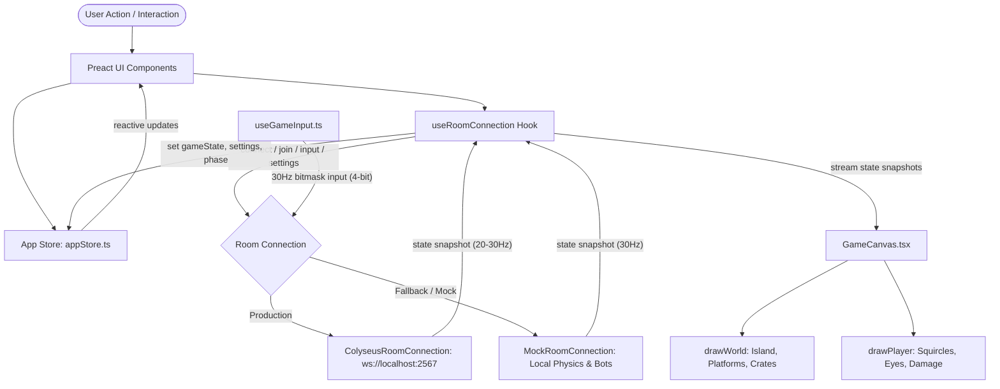

# Mutator Party: Frontend Architecture & Implementation Plan

> **Comprehensive, Beginner-to-Advanced Guide for Developers, Designers, and Contributors**  
> *Last updated: October 2026 (Refactored to Modular Clean Architecture)*

---

## 1. Executive Overview

**Mutator Party** is a fast-paced, mobile-first browser multiplayer party brawler. Up to 8 players battle on a procedural floating island through rapid-fire rounds with shifting gameplay modes and wacky physics twists picked by whoever is losing.

### Core Philosophy
1. **Zero Setup Friction**: A player clicks a link (or enters a 5-letter room code) on their phone or desktop and is playing within seconds.
2. **Server-Authoritative with Local Fallback**: All game rules, arena collisions, and physics run through the authoritative `@mutator-party/shared` package. If the backend WebSocket server (`ws://localhost:2567`) is offline, the client automatically falls back to an in-browser **Mock Server** populated with intelligent bots so development and testing never stall.
3. **Separation of Canvas & DOM (Spec Rule 2)**:
   - **Canvas 2D Engine**: Renders only the physics world (clouds, procedural arena platforms, squircle characters, directional eyes, items, hazards, particle effects, and dynamic twist overlays).
   - **Preact DOM Layer**: Renders all UI overlays (title, buttons, settings cards, character speech bubbles, countdown HUD, scoreboards, and pick modals).
4. **Modular & Readable Codebase**: Every screen and system is broken into small, single-responsibility files (mostly under 50–150 lines), making it straightforward for any engineer to read, understand, debug, and extend.

---

## 2. Directory Structure & File Map

```text
apps/client/
├── index.html                           # HTML template with Google fonts & #app mount
├── package.json                         # Dependencies & scripts
├── vite.config.ts                       # Vite build config with Preact preset
├── src/
│   ├── main.tsx                         # Ultra-clean app bootstrap (7 lines)
│   ├── App.tsx                          # Top-level screen router & event orchestrator
│   │
│   ├── app/
│   │   └── store.ts                     # Reactive lightweight store (state, profile, screen)
│   │
│   ├── hooks/
│   │   └── useRoomConnection.ts         # Room lifecycle, WebSocket listeners & action dispatchers
│   │
│   ├── net/
│   │   ├── connection.ts                # TypeScript interfaces for RoomConnection & options
│   │   ├── colyseusConnection.ts        # Production Colyseus WebSocket client
│   │   └── mockServer.ts                # Standalone in-browser mock server with bots
│   │
│   ├── game/
│   │   ├── GameCanvas.tsx               # Main 60fps Canvas2D game loop & state interpolation
│   │   ├── audio.ts                     # WebAudio synthesized sound synthesizer (jump, shove, ko)
│   │   ├── theme.ts                     # 7 Arena visual themes (Sunny, Neon, Frozen, Space, etc.)
│   │   ├── hooks/
│   │   │   └── useGameInput.ts          # 30Hz keyboard & touch input streaming with bitmask packing
│   │   └── render/
│   │       ├── drawUtils.ts             # Canvas primitives: rounded rects, pop-art panels, stylized text
│   │       ├── drawWorld.ts             # Sky gradients, clouds, procedural platforms, crumbling tiles
│   │       └── drawPlayer.ts            # Squircle bodies, cartoon eyes, damage %, bomb fuse, crown
│   │
│   ├── ui/
│   │   ├── Landing.tsx                  # Home screen (nickname, color swatch, Create/Join tabs)
│   │   ├── Settings.tsx                 # Host room configuration (Match, Arena, Modes, Safety)
│   │   ├── Lobby.tsx                    # Pre-game room (8-player lineup, ready toggles, reactions)
│   │   ├── Hud.tsx                      # In-game heads-up display (round pill, timer, score list)
│   │   ├── PickOverlay.tsx              # Last-place twist selection overlay (3 interactive cards)
│   │   ├── ResultsOverlay.tsx           # Round standings & final winner celebration podium
│   │   ├── PortraitRotateSplash.tsx     # Orientation warning prompt for mobile portrait users
│   │   ├── TapToContinueOverlay.tsx     # Fullscreen trigger overlay for iOS/Android browsers
│   │   │
│   │   ├── landing/                     # Modular Landing Subcomponents
│   │   │   ├── useLandingForm.ts        # Form state: nickname, randomizer dice, code boxes, validation
│   │   │   ├── LandingTitle.tsx         # Animated sticker-pop logo wordmark
│   │   │   ├── LandingBackground.tsx    # Parallax clouds, sun, and mountain hills
│   │   │   ├── NameInputRow.tsx         # Nickname field + randomizer dice button
│   │   │   ├── ColorPaletteRow.tsx      # 8 circular character color swatches
│   │   │   ├── CreateTabContent.tsx     # Tab 1: Create room description & CTA
│   │   │   ├── JoinTabContent.tsx       # Tab 2: Join code instructions & CTA
│   │   │   ├── JoinCodeBoxes.tsx        # 5 distinct squircle code input boxes
│   │   │   └── LandingHeaderActions.tsx # Desktop fullscreen toggle button
│   │   │
│   │   ├── settings/                    # Modular Settings Subcomponents
│   │   │   ├── useSettingsForm.ts       # Manages form state, presets (Chaos, Classic, etc.), validation
│   │   │   ├── SettingsHeader.tsx       # Presets chips, Rules/Safety tab switch, fullscreen button
│   │   │   └── SettingsActions.tsx      # Floating action bar (Reset defaults, Cancel, Save)
│   │   │
│   │   ├── create-room/                 # Setting Cards A through G + Tab H
│   │   │   ├── CardA_MatchPlayers.tsx   # Players count, bots toggle, rounds, round time
│   │   │   ├── CardB_Arena.tsx          # Platform count, island size (S/M/L), symmetry
│   │   │   ├── CardC_Modes.tsx          # Brawl, Bomb Tag, Crown Rush pool selection
│   │   │   ├── CardD_Hurdles.tsx        # 13 Twists pool, ramp mode, hazard toggles
│   │   │   ├── CardE_Respawn.tsx        # Lives, respawn delay, invulnerability shield
│   │   │   ├── CardF_Items.tsx          # Power-up items (Mega, Freeze, Swap, Shield)
│   │   │   ├── CardG_Theme.tsx          # Fixed vs. rotating sky and arena themes
│   │   │   ├── TabH_RoomSafety.tsx      # Room name, public/private, password, chat filter
│   │   │   ├── components.tsx           # Reusable form steppers, sliders, segmented toggles
│   │   │   └── constants.ts             # Default values, ranges, and option labels
│   │   │
│   │   ├── lobby/                       # Modular Lobby Subcomponents
│   │   │   ├── useLobbyEmotes.ts        # Manages speech bubble timers, animations, and sound triggers
│   │   │   ├── useRulesSummary.ts       # Shared logic calculating human-readable rules summary text
│   │   │   ├── PlayerSlotCard.tsx       # Animated character pod with speech bubble, crown, kick button
│   │   │   ├── BotSlotCard.tsx          # Dashed placeholder card showing "Bot joins at start"
│   │   │   ├── PlayerGrid.tsx           # 1x8 (or 2x4 on mobile) responsive slot lineup grid
│   │   │   ├── PlayerSpeechBubble.tsx   # Comic-book speech bubble popup with pointer tail
│   │   │   ├── RoomCodeHeader.tsx       # Big colorful room code tiles, copy button, share link
│   │   │   ├── QuickEmotesBar.tsx       # Arcade reaction deck (😂, 🔥, 🎉, 👀, 💪, 💩, 😈, 👏)
│   │   │   ├── LobbyActions.tsx         # Start Game (Host) / Ready Toggle (Guest) launchpad
│   │   │   ├── RulesModal.tsx           # Detailed rules popup dialog for non-host guests
│   │   │   ├── ExpandableRules.tsx      # Collapsible quick-reference rules drawer
│   │   │   └── RulesSummaryTable.tsx    # Compact table of active modes, rounds, and items
│   │   │
│   │   ├── hud/                         # Modular In-Game HUD
│   │   │   ├── RoundModeBadge.tsx       # Top-left round pill (Round 1/5) & game mode badge
│   │   │   ├── TimerTwistBar.tsx        # Top-center giant countdown timer & active twist pills
│   │   │   ├── PlayerScoreList.tsx      # Top-right real-time scoreboard list with leader crown
│   │   │   └── AudioMuteButton.tsx      # Top-right sound mute toggle button
│   │   │
│   │   ├── pick/                        # Modular Twist Pick
│   │   │   └── TwistCard.tsx            # Interactive card with icon, title, description, badge (1, 2, 3)
│   │   │
│   │   ├── results/                     # Modular Results & Standings
│   │   │   └── PlayerStandingRow.tsx    # Leaderboard row showing player avatar, points added, total
│   │   │
│   │   └── components/                  # Global Reusable Components
│   │       ├── AvatarHead.tsx           # Main squircle character face container
│   │       ├── avatar/
│   │       │   ├── AvatarEyes.tsx       # Expressions (Devil \ /, Laugh ^ ^, Shock O O, Fire > <)
│   │       │   └── AvatarMouth.tsx      # Expressions (Smile, Laugh, Grimace, Tongue out, Fangs)
│   │       ├── BannerAd.tsx             # Responsive advertisement placeholder container
│   │       ├── ConnectingOverlay.tsx    # Fullscreen loading spinner while room connects
│   │       ├── Icons.tsx                # Lightweight SVG icons (Settings, Rules, Exit, Gamepad, etc.)
│   │       ├── SparkleStar.tsx          # Cartoon twinkling star particle
│   │       ├── Toast.tsx                # Global toast notifications banner
│   │       └── TouchControls.tsx        # On-screen D-pad and action buttons (Left, Right, Jump, Shove)
│   │
│   ├── styles/
│   │   ├── tokens.css                   # Design tokens: palette, typography, outlines, shadows
│   │   ├── base.css                     # Global reset, body setup, safe area insets, touch hygiene
│   │   ├── landing.css                  # Styles for Landing screen, card, code boxes, and tabs
│   │   ├── lobby.css                    # Styles for player pods, speech bubbles, rules, and lineup
│   │   └── settings.css                 # Styles for the Settings panel, grid layout, and floating bar
│   │
│   └── util/
│       ├── fullscreen.ts                # Fullscreen API helper with iOS/Android auto-request handling
│       ├── logger.ts                    # Color-coded client logging (net, state, action, game)
│       ├── storage.ts                   # Safe localStorage wrapper for player nickname & preferences
│       └── toast.ts                     # Toast dispatcher (`showToast("Message", "info" | "error")`)
```

---

## 3. Architecture & Data Flow



### Key Principles of State & Lifecycle
1. **Lightweight App Store (`app/store.ts`)**:
   - Uses a tiny pub-sub pattern (`getState()`, `setState()`, `subscribe()`).
   - Tracks `currentScreen` (`landing` | `settings` | `lobby` | `game`), `roomCode`, `isHost`, `settings`, `gameState`, and player `profile`.
2. **Phase-Driven Screen Navigation**:
   - Server state phase is authoritative. When `gameState.phase` transitions:
     - `lobby` ➔ Activates the Lobby screen.
     - `intro`, `play`, `pick`, `results`, `final` ➔ Activates the Game screen.
     - On leaving or disconnect ➔ Returns to `landing`.

---

## 4. The Canvas 2D Engine

Rather than relying on heavy third-party gaming bundles, the frontend utilizes a high-performance, lightweight **HTML5 Canvas 2D Engine**:

### 1. 1:1 Server Geometry Alignment
- The arena platforms and island floor tiles are generated dynamically using `generateArena()` from `@mutator-party/shared`.
- Platform coordinates, width, and collision boxes rendered on canvas match the server physics simulation down to the exact sub-pixel.

### 2. Cartoon Sticker-Pop Visuals
- **Squircles**: Players are drawn as rounded rectangular squircles (`drawPlayer.ts`) with a corner radius of 32%.
- **Directional Eyes**: Pupils automatically look in the player's movement direction based on velocity `vx`.
- **Dynamic Face Emotions**: When players emote (e.g. `😈`, `😂`, `👀`, `🔥`), their canvas avatar and lobby avatar change their facial expressions in real time.
- **Damage % Tint**: A player's damage percentage ramps dynamically:
  - `< 30%`: White
  - `30% - 60%`: Warning Orange (`#FF9F1C`)
  - `> 60%`: Critical Red (`#FF4D4D`)

### 3. Dynamic Hazard & Twist Overlays
- **Lights Out (`dark`)**: Renders a dark midnight canvas overlay (`rgba(12, 12, 28, 0.92)`) with dynamic circular spotlight cutouts centered on each active player using `globalCompositeOperation = "destination-out"`.
- **Crumbling Floor (`crumble`)**: Island floor tiles read bitmasks `crumbleWarnBitmask` (shakes violently and flashes red) and `crumbleTilesBitmask` (drops platform completely into the abyss).
- **Ice Rink (`ice`)**: Shifts platform surfaces to glassy cyan with slippery visual aesthetics.
- **Trampoline Land (`bounce`)**: Shifts platform surfaces to bouncy pink.

---

## 5. Input Streaming & Netcode Protocol

### 1. 4-Bit Compact Input Mask
Player inputs are sampled at **30 Hz** inside `useGameInput.ts` and encoded into a single 4-bit integer mask:
- `Bit 0 (1)`: Left (`A`, `←`, or Touch Left)
- `Bit 1 (2)`: Right (`D`, `→`, or Touch Right)
- `Bit 2 (4)`: Jump (`W`, `↑`, `Space`, or Touch Jump)
- `Bit 3 (8)`: Shove (`E`, `Shift`, `J`, or Touch Shove)

### 2. Delta & Heartbeat Transmission
- Inputs are transmitted immediately when the bitmask changes.
- If the player holds a key without changing, a **heartbeat packet** is sent every 100 ms.
- Sequence counter `seq` increments with each transmission and rolls over at `0xFFFF` (16-bit uint).

---

## 6. Detailed Screen Breakdown

### Screen 1: Landing (`ui/Landing.tsx`)
- **Nicknames**: Defaults to saved name in localStorage or "Satya", editable with a randomizer dice button (`FUN_NAMES`).
- **Color Selector**: 8 distinct player colors (`PLAYER_COLORS`).
- **Tabs**:
  1. *Create Room*: Quick host option that initiates a room and takes host to the Lobby.
  2. *Join Room*: 5 squircle input boxes supporting automatic advance, backspace navigation, and full-code paste.
- **Desktop Fullscreen**: Top-right compact fullscreen toggle button.

### Screen 2: Room Settings (`ui/Settings.tsx`)
- Host-only complete rules configurator.
- **Presets**: Chaos Party (default), Classic, Tournament, Chill, and Custom.
- **Cards A–G**:
  - `Card A`: Max players (2–12), Min players, Fill bots, Bot skill (Easy/Normal/Hard), Rounds, Round time.
  - `Card B`: Platform count (2–8), Island size (S/M/L), Layout (Every round / Per match / Classic), Mirror symmetry.
  - `Card C`: Mode pool (Brawl, Bomb Tag, Crown Rush), Mode order, Twist picker rule.
  - `Card D`: 13 Twists pool toggles, Twist ramp mode (1, 2, 3, or Ramp 1➔3).
  - `Card E`: Respawn mode (Off, Lives, Unlimited), Lives count, Respawn delay, Shield duration.
  - `Card F`: Power-ups enabled, items pool (Mega, Freeze, Swap, Shield), spawn spots count.
  - `Card G`: Arena theme (Fixed, Rotate, Random, Custom), choice of 7 themes.
- **Tab H**: Room name, privacy (Public/Private), password, emote filter, spectators allowed, host kick allowed.
- **Floating Action Bar**: Reset to preset defaults (`↺`), Discard changes (`✕`), Save settings (`✓`).

### Screen 3: Lobby (`ui/Lobby.tsx`)
- **Room Code Header**: 5 large colorful pop-art letter tiles with one-click copy and share link.
- **1x8 Lineup Grid**: Visual player pods showing each character squircle, host crown, ready badges (`✓ Ready` vs `⏳ Wait`), and host kick buttons. Empty slots render as dashed bot placeholders.
- **Quick Reaction Deck**: 8 animated emoji buttons (`😂`, `🔥`, `🎉`, `👀`, `💪`, `💩`, `😈`, `👏`). Emotes trigger comic-book speech bubbles (`PlayerSpeechBubble.tsx`) over the player's pod with pop-in squish animations.
- **Lobby Actions**: Host "Start Game" button (with unready guest counter warning) or Guest "Ready" toggle.
- **Rules Reference**: Guests can open the read-only `RulesModal.tsx` to inspect all active room settings.

### Screen 4: In-Game Canvas & Overlays (`ui/Hud.tsx`, `ui/PickOverlay.tsx`, `ui/ResultsOverlay.tsx`)
- **HUD**:
  - Top-left: Round indicator and current mode pill.
  - Top-center: Giant countdown timer (pulses red when under 10 seconds) and active twist pills.
  - Top-right: Scoreboard ranking list with leader crown and audio mute toggle.
- **Pick Overlay**:
  - Displays when phase enters `pick`.
  - The designated picker (usually last place) sees 3 twist cards with countdown timer (10s) and keyboard shortcuts (`1`, `2`, `3`). Non-pickers see who is choosing.
- **Results Overlay**:
  - Displays at round end with standings and point increments (`+pts`).
  - At match final, crowns the party winner with celebratory gold text and a "Rematch" option for the host.

---

## 7. Responsive Design & Touch Handling

1. **Orientation Guard (`PortraitRotateSplash.tsx`)**:
   - The game is designed for landscape party play.
   - If a mobile user holds their device in portrait, an animated splash appears instructing them to rotate their screen to landscape.
2. **Mobile Landscape Fullscreen (`TapToContinueOverlay.tsx`)**:
   - Modern mobile browsers require user interaction to request fullscreen.
   - When opened in mobile landscape, an unobtrusive "Tap to Play in Fullscreen" overlay appears and cleanly engages fullscreen mode on the first tap.
3. **Touch Hygiene (`base.css`)**:
   - Disables iOS/Android callout menus, text selection, and blue highlight boxes (`-webkit-touch-callout: none; -webkit-tap-highlight-color: transparent;`).
   - Forms and text fields retain full native text selection.

---

## 8. Development & Build Verification

```bash
# 1. Install workspace dependencies
pnpm install

# 2. Run local development server
pnpm --filter client dev

# 3. Test client TypeScript compilation and Vite production bundle
pnpm --filter client build

# 4. Build entire workspace (Shared + Client + Server)
pnpm build
```

---

## 9. Code Quality & Modularity Standards

To maintain clean code readability:
1. **File Length Limit**: Keep single component and hook files between 40 and 200 lines.
2. **Single Responsibility**:
   - Extract stateful forms into custom hooks (`useSettingsForm`, `useLandingForm`, `useLobbyEmotes`).
   - Extract complex SVG drawings and expressions into dedicated subcomponents (`AvatarEyes`, `AvatarMouth`).
   - Keep styling in dedicated `.css` files (`landing.css`, `lobby.css`, `settings.css`) rather than multi-hundred-line inline `<style>` strings.
3. **No Direct Backend Coupling**: All network operations pass through `RoomConnection`. Components never import Colyseus directly.
4. **Shared Types**: Always import game rules, mode definitions, themes, and settings types from `@mutator-party/shared`. Never duplicate constants.

