# Mutator Party: Product, Design and Build Spec

**Version:** v3 plan (documents the working v2 demo and everything we decided to add)
**Date:** 11 October 2026
**Status:** Planning document. The demo in section 2 is real and playable. Everything marked **MOCKUP** or **PLANNED** is not built yet.

> **Read this first.** Sections 1 to 3 explain the idea and what already works. Sections 4 to 7 are the new features you asked for (name prompt, host controls, random arenas, first-to-reach power-ups, themes). Section 8 lists every font, color and icon choice. Section 10 is how to make money. Section 11 is the long list of things that are easy to forget. Section 13 has copy-paste-ready code.

---

## Table of contents

1. The idea in one page
2. What exists today (the v2 demo)
3. Player journey and the name prompt
4. Host controls: the Create Room screen
5. Randomized arenas (a new layout every round)
6. Power-ups and the "first to reach" rule
7. Themes and round-wise theme change
8. Design system: fonts, colors, icons, sound, motion
9. Technical architecture
10. How to make money
11. Things you may have forgotten (care checklist)
12. Roadmap and effort
13. Appendices (settings schema, twist catalog, physics constants, protocol, code, test plan)

---

## 1. The idea in one page

**Pitch:** a free, instant-play party game in the browser. 2 to 12 friends join with one link. Every round is a different **game mode** plus one to three **rule twists** (low gravity, reversed controls, crumbling floor and so on). Rounds last about a minute, so a full session is about 5 to 8 minutes.

**Why this can spread** (lessons from Skribbl.io and Smash Karts, your two favourites):

| What those games do | What we copy |
|---|---|
| No login. You are playing in about 10 seconds. | Name prompt only, no account. |
| The rules fit in one sentence. | "Shove everyone off." "Don't hold the bomb." "Hold the crown." |
| Short rounds, so "one more game" is easy. | 45 to 75 second rounds. |
| Players create the funny moments, not the designer. | Chaos twists plus power-ups plus player-picked rules. |
| Friends invite friends with a link. | Room codes and a WhatsApp share button. |
| Cheap to run. | Small 2D game, tiny network messages. |

**Five product pillars**

1. **Instant.** Link to playing in under 15 seconds.
2. **Chaos you can explain in one sentence.**
3. **Host control.** The room creator decides the rules, so every room feels like "our game".
4. **Fair comeback.** The player in last place picks the next twist.
5. **Clip-able.** Every big moment (a knockout, a bomb blast, a crown steal) is worth a screenshot or a short clip.

**Glossary**

| Word | Meaning |
|---|---|
| Room | One private match with a code, like `KPQ7X`. |
| Host | The player who created the room. Controls the rules. |
| Mode | The objective of a round: Last One Standing, Bomb Tag, Crown Rush. |
| Twist (also called hurdle or mutator) | A rule change such as Moon Gravity. 1 to 3 per round. |
| Hazard | A physical obstacle (spikes, bumpers). Planned, not built. |
| Crate / power-up | A pickup that gives one special move. |
| Power spot | A fixed location where a crate appears. |
| Arena | The platforms and island for one round. |
| Theme | The visual style (colors, background, particles, music). |

---

## 2. What exists today (the v2 demo)

The v2 demo is one HTML file. You play against 7 bots on one screen. Nothing is online yet.

### 2.1 Screenshots (real, captured from the game code)

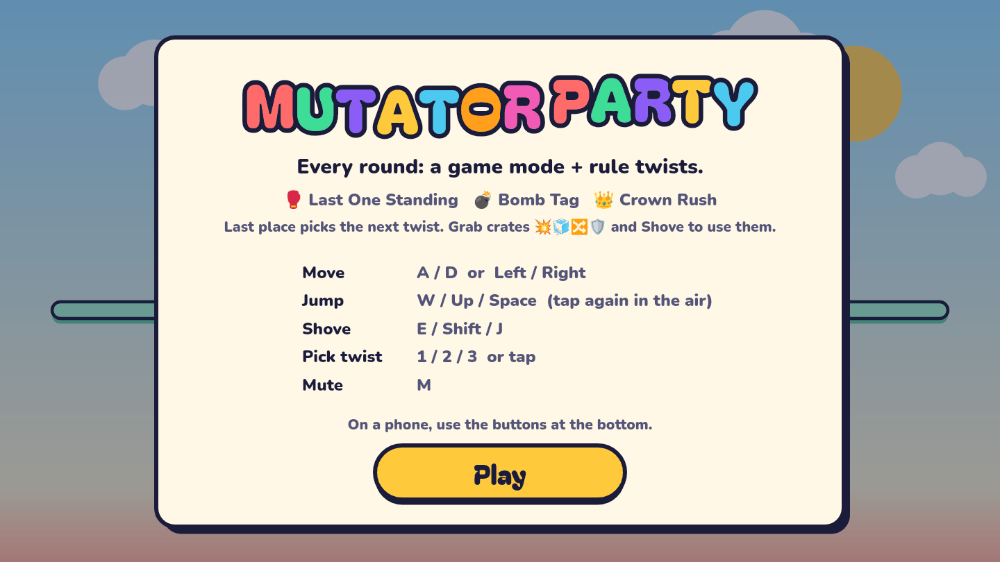
*Figure 2.1: Menu. Controls and the three modes are listed.*

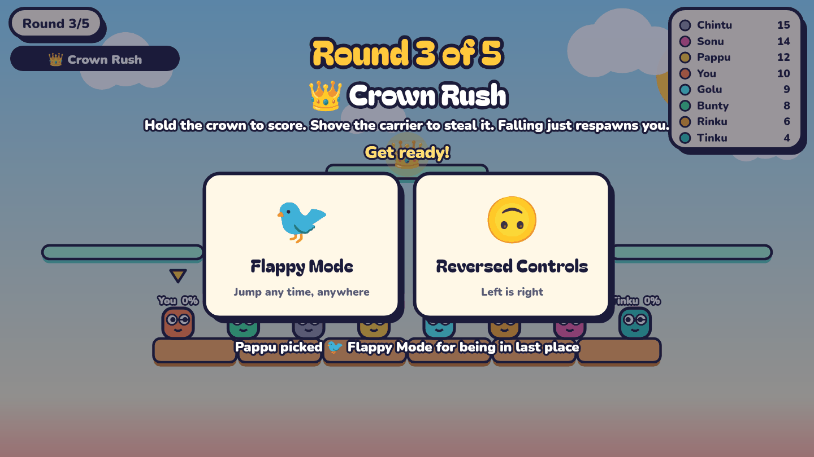
*Figure 2.2: Round intro. The mode is shown first, then the twist cards lock in one by one. The last-place player (Pappu) picked the first twist.*

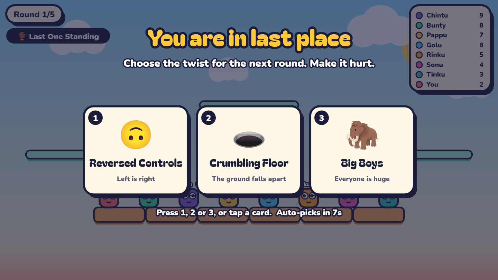
*Figure 2.3: When you are in last place you choose between 3 twist cards (keys 1, 2, 3 or tap). This is the "selecting option" you liked.*


*Figure 2.4: Last One Standing with the Size Lottery twist. A power-up crate sits on the island.*

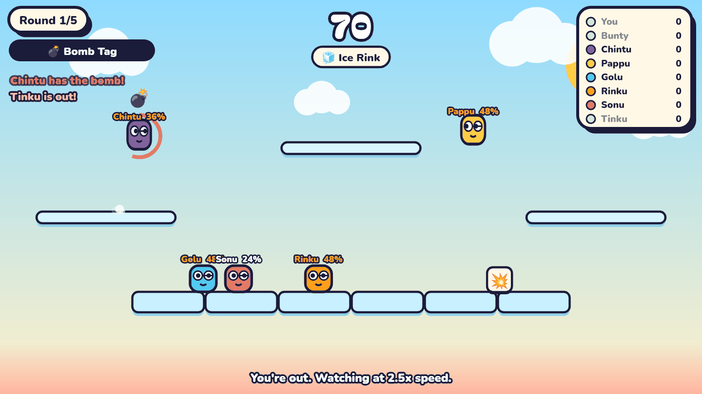
*Figure 2.5: Bomb Tag with Ice Rink. The holder has a bomb icon and a red fuse ring. The feed on the left narrates events.*

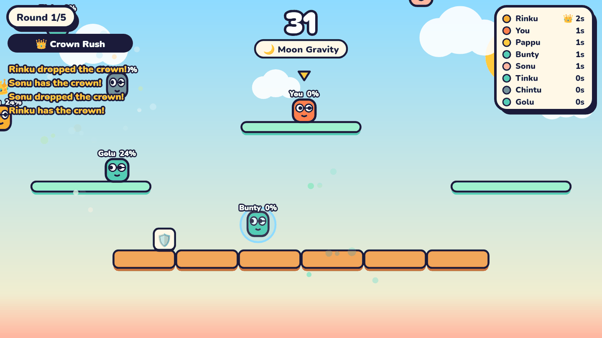
*Figure 2.6: Crown Rush with Moon Gravity. The scoreboard switches to crown seconds. A shield crate is on the floor.*

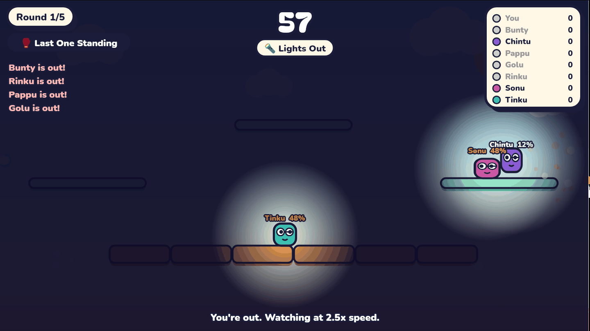
*Figure 2.7: Lights Out. You only see players near a light circle.*

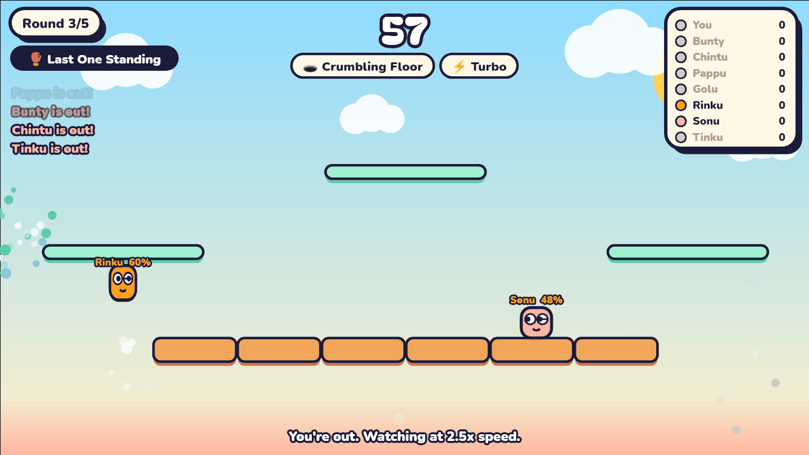
*Figure 2.8: Crumbling Floor plus Turbo. The red tile is about to fall.*

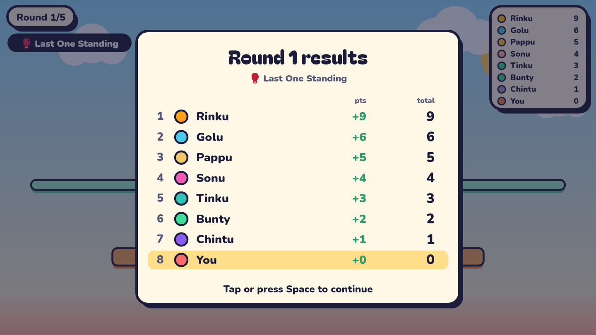
*Figure 2.9: Round results with points and totals.*

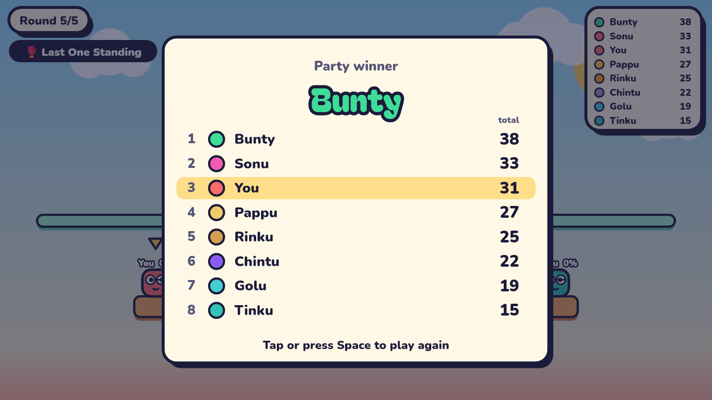
*Figure 2.10: Final standings after 5 rounds.*

### 2.2 What is in the demo

- 3 modes: Last One Standing, Bomb Tag, Crown Rush.
- 13 twists in 5 categories (gravity, size, controls, jumping, world).
- 4 power-ups: Mega Shove, Freeze Burst, Swap, Shield.
- "Last place picks the next twist" with 3 cards.
- 7 bots (player vs bots on one screen), keyboard and touch controls.
- Game feel: freeze-frame on hard hits, slow motion on the last knockout, screen shake, text feed.

### 2.3 Honest list of what is missing or wrong

| Problem | Why it matters |
|---|---|
| No online play. | The real product needs rooms, a server and many humans. |
| Arena is the same every round. | You noticed this. Fixed in section 5. |
| **Rounds are much too short in bot-only tests.** | See 2.4. |
| Bots are simple (chase, flee, shove). | Fine for a demo, not for fun solo play. |
| No name entry, no host settings, no themes. | Sections 3, 4 and 7. |
| Keys use the typed letter, not the key position. | Breaks on non-QWERTY keyboards. Use `event.code` (section 11). |
| Emoji icons look different on every phone. | Section 8.3 has the fix. |

### 2.4 Measured balance problem (important)

While preparing these docs I ran the game code headless with 8 bots (the human player idle) and timed how long each round lasted:

| Mode | Rounds simulated | Average | Shortest | Median | Longest | Intended |
|---|---|---|---|---|---|---|
| Last One Standing | 24 | 11.8 s | 3.9 s | 10.0 s | 45.5 s | 40 to 60 s |
| Bomb Tag | 24 | 9.8 s | 3.9 s | 10.8 s | 18.2 s | 45 to 75 s |
| Crown Rush | 8 | 46.5 s | 46.5 s | 46.5 s | 46.5 s | 45 s (timer) |

Brawl and Bomb rounds end four to six times faster than intended. The likely causes (not yet fixed, listed so we can tune them):

1. Shove knockback is too strong: base force 620 plus 70 per hit is large for a 600 px island.
2. Bots walk off edges and chase targets near edges (the "suicidal bot" chance is 8 percent per decision).
3. Bomb Tag passes also kick both players sideways (260 px/s) and the explosion shockwave (760 px/s) pushes bystanders off the island.
4. There is no safety margin at the island edge and no ring-out grace time.

**Tuning targets for v3:** Brawl 40 to 60 s, Bomb 45 to 75 s. Start by lowering base knockback to about 420, removing the sideways kick on bomb passes, adding an edge-safety check for bots, and capping shockwave speed at about 500. Re-run the same timing test after every change (section 13.8).

---

## 3. Player journey and the name prompt

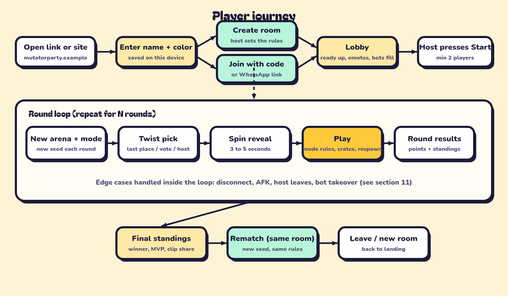
*Figure 3.1: Player journey from first visit to rematch.*

### 3.1 Name prompt (your first requirement)

**When it appears:** the first time someone opens the game (home page, a room link, or a room code). The prompt must appear **before** they can create or join a room.

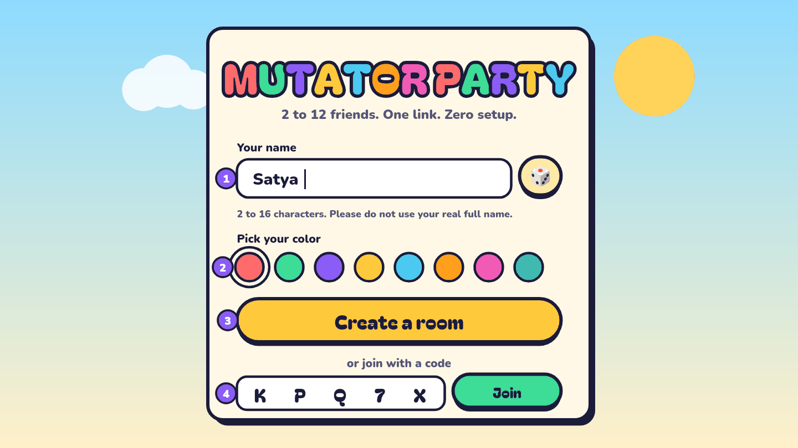
*Figure 3.2 (MOCKUP): Landing screen. 1 = name box with a dice button for a random name. 2 = color picker. 3 = Create a room. 4 = Join with code.*

**Rules for the name**

| Rule | Value | Reason |
|---|---|---|
| Length | 2 to 16 characters, trimmed | Fits on screen and in the scoreboard. |
| Allowed | Letters (any language), digits, space, `_`, `-`, `'` | Blocks symbols used for tricks. |
| Not allowed | URLs, e-mails, phone numbers, repeated spaces | Privacy and spam. |
| Reserved | `You`, `Host`, `Admin`, `Bot`, `System`, names of the bots | Prevents impersonation. |
| Profanity | Filter on the server (English and Hinglish list, plus leetspeak and look-alike letters) | The server must check, never only the browser. |
| Duplicates | If taken in the room, add `#2`, `#3` | Everyone stays distinguishable. |
| Random name | Dice button gives something like "Sleepy Samosa" | Removes the blank-page problem, great for mobile. |
| Memory | Save the name and color in the browser (`localStorage`) | Returning players skip the prompt (but can edit). |
| Privacy hint | "Please do not use your real full name." | Many players are young. |

**Guest identity:** at first visit the browser creates a random `playerId` (UUID) and the server gives back a signed `sessionToken`. This allows reconnecting after a dropped connection without any account.

**Joining by link:** `https://yourdomain/r/KPQ7X`. If the player has no saved name, show the name prompt first and then drop them into the lobby of room `KPQ7X`.

### 3.2 Lobby

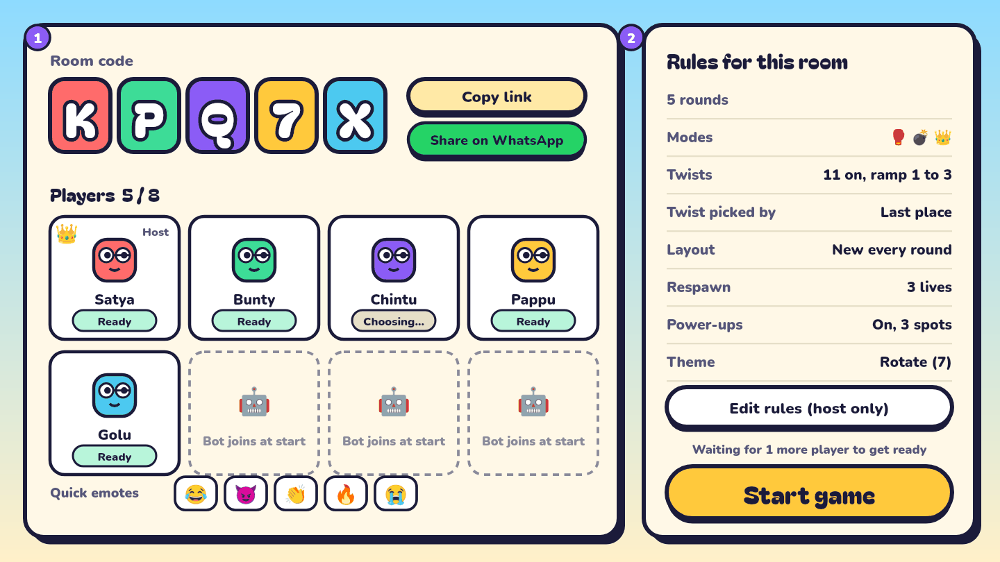
*Figure 3.3 (MOCKUP): Lobby. 1 = room code and share buttons. 2 = rules summary. The host sees Edit rules and Start.*

| Element | Behaviour |
|---|---|
| Room code | 5 characters from an alphabet without look-alikes (no 0, O, 1, I, L). Big, tap to copy. |
| Share | "Copy link" and "Share on WhatsApp" (use the Web Share API on phones). |
| Players | Shows up to max players. Each shows Ready or Choosing. Host has a crown. |
| Bots | Empty slots fill with bots at start if the host allows it. |
| Rules summary | Read-only for guests, editable for the host. |
| Start | Host only. Needs at least 2 players (bots count if allowed). |
| Emotes | A small fixed set of emoji (safe by design, no free text needed). |

### 3.3 Edge cases to design for

| Situation | What should happen |
|---|---|
| Player loses connection | Keep their slot for 30 seconds. A bot plays for them. They resume when they reconnect. |
| Host leaves | The longest-connected human becomes host. Announce it in the feed. |
| Room full | Show "Room full" with option to spectate if spectators are allowed. |
| Wrong code | "We could not find that room." No hints about similar codes. |
| Two players pick the same name | Auto-suffix `#2`. |
| Player idle (AFK) | Warn at 15 s of no input in a round, bot takes over at 30 s, move to spectator after 2 missed rounds. |
| Game already started | New arrivals watch until the next round or the next match. |

---

## 4. Host controls: the Create Room screen

This is the screen where the creator chooses **everything**: how many platforms, how many rounds, how many players, which hurdles are allowed, respawn on or off, themes and more. The letters A to G below match the letters on the mockup.

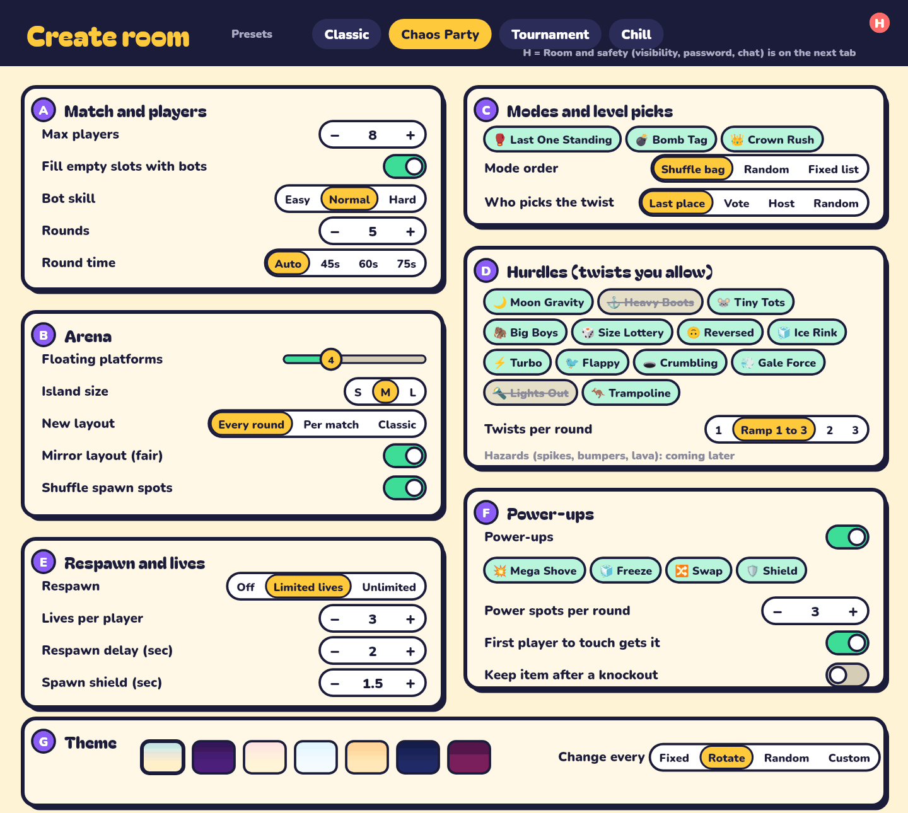
*Figure 4.1 (MOCKUP): Create Room. Sections A to G. A section H (room and safety) sits on a second tab.*

### 4.1 Presets (one tap, then tweak)

| Preset | What it sets |
|---|---|
| Classic | 3 modes, 1 twist per round, respawn off, fixed layout, no power-ups. |
| Chaos Party (default) | All modes and twists, ramp 1 to 3 twists, new layout each round, power-ups on, 3 lives. |
| Tournament | 10 rounds, no power-ups, no respawn, mirrored fixed seed, last-place picks off. |
| Chill | Fewer twists, unlimited respawn, big island, easy bots. |
| Custom | Anything the host changes. |

### 4.2 Every setting (complete list)

**A. Match and players**

| Setting | Type | Default | Range / options | Notes |
|---|---|---|---|---|
| `maxPlayers` | number | 8 | 2 to 12 | Hard cap 12 for the MVP (performance and screen space). |
| `minPlayersToStart` | number | 2 | 2 to max | Bots can fill the rest. |
| `fillBots` | on/off | on | | Bots join at start so rooms never feel empty. |
| `botSkill` | choice | normal | easy, normal, hard | Changes reaction time and edge awareness. |
| `rounds` | number | 5 | 1 to 15 | Also offer "Best of" later. |
| `roundTime` | choice | auto | auto, 30 to 120 s | Auto uses the mode default (60 / 75 / 45). |
| `scoring` | choice | standard | standard, winner_plus, kills | Standard = placement points, bonus for a clear winner. |
| `spectators` | on/off | on | | People who join late or are out. |

**B. Arena** (see section 5)

| Setting | Type | Default | Range / options | Notes |
|---|---|---|---|---|
| `platformCount` | number | 4 | 2 to 8 | Floating platforms only. The island is separate. |
| `islandSize` | choice | M | S (4 tiles), M (6), L (8) | Tile width is 100 px. |
| `layout` | choice | every_round | every_round, per_match, classic | Classic = the fixed v2 layout. |
| `mirror` | on/off | on | | Left-right symmetric layout. Fairer. |
| `shuffleSpawns` | on/off | on | | Who starts where changes every round. |

**C. Modes and level-wise picks**

| Setting | Type | Default | Options | Notes |
|---|---|---|---|---|
| `modes.pool` | multi-select | all 3 | brawl, bomb, crown (more later) | Host can exclude modes. |
| `modes.order` | choice | shuffle_bag | shuffle_bag, random, fixed | Shuffle bag = every mode once before repeating. Fixed = host orders them round by round. |
| `modes.twistPicker` | choice | last_place | last_place, vote, host, random, round_robin | This is the "random level-wise pick" family. |

How each twist picker works:

| Picker | Flow |
|---|---|
| last_place | Lowest total score sees 3 random twist cards and picks one. A bot picks if it is a bot. |
| vote | Everyone sees 3 cards for 8 seconds. Most votes wins, ties are random. |
| host | The host picks every round. Good for tournaments. |
| random | The server picks. |
| round_robin | Each player picks once in turn. |

**D. Hurdles (twists and hazards the host allows)**

| Setting | Type | Default | Notes |
|---|---|---|---|
| `twists.allowed` | multi-select | all 13 | Tick or untick each one. Empty list is allowed (no twists). |
| `twists.perRound` | choice | ramp | 1, 2, 3 or ramp (1, 1, 2, 2, 3). |
| `twists.themeLinked` | on/off | off | If on, the theme brings its own twist (Frozen Peak adds Ice Rink). |
| `hazards.allowed` | multi-select | none | Planned (section 13.2). Spikes, bumpers, moving platforms, lava and so on. |

Rule: never pick two twists from the same category in one round (for example Moon Gravity and Heavy Boots). The v2 demo already does this.

**E. Respawn and lives**

| Setting | Type | Default | Range | Notes |
|---|---|---|---|---|
| `respawn.mode` | choice | lives | off, lives, unlimited | Off = classic elimination. |
| `respawn.lives` | number | 3 | 1 to 9 | Used when mode is lives. |
| `respawn.delaySec` | number | 2 | 1 to 5 | Time before coming back. |
| `respawn.shieldSec` | number | 1.5 | 0 to 3 | Protection after respawn so you are not killed instantly. |
| `respawn.where` | choice | random_platform | random_platform, center, top | Where the player re-enters. |

With respawn on, a round ends by timer (or when only one player has lives left), and the winner is decided by lives left, then by points.

**F. Power-ups** (see section 6)

| Setting | Type | Default | Notes |
|---|---|---|---|
| `items.enabled` | on/off | on | Master switch. |
| `items.allowed` | multi-select | all 4 | Mega Shove, Freeze, Swap, Shield. |
| `items.spots` | number | 3 | Number of power spots per round (0 to 5). |
| `items.firstTouch` | on/off | on | The first player to touch a spot gets the crate. |
| `items.keepOnKO` | on/off | off | If on, an item stays with the player after a knockout. |

**G. Theme** (see section 7)

| Setting | Type | Default | Options |
|---|---|---|---|
| `theme.mode` | choice | rotate | fixed, rotate, random, custom |
| `theme.fixed` | theme id | sunny | any of the 7 |
| `theme.perRound` | list | empty | Used by custom. One theme per round. |

**H. Room and safety** (second tab)

| Setting | Type | Default | Options |
|---|---|---|---|
| `room.name` | text | "{name}'s room" | Up to 24 characters, filtered. |
| `room.visibility` | choice | private | private (code only), public (listed) |
| `room.password` | text | empty | Optional, up to 12 characters. |
| `room.chat` | choice | emotes | off, emotes, filtered |
| `room.spectators` | on/off | on | |
| `room.allowKick` | on/off | on | Host can kick. Vote kick later. |

### 4.3 Rules the server must enforce

1. Only the host can change settings. Everyone else gets a read-only copy.
2. The server **validates and clamps every value** (section 13.3 has a ready function). Never trust the browser.
3. Settings are locked during a round. Some (theme, twist picker) can change between rounds.
4. Every change is broadcast as `settings:update` so lobby and host screens stay in sync.
5. The settings object has a `version` number so old clients can be handled after updates.
6. Show "Reset to preset" and "Save as my preset" (saved in the browser).

---

## 5. Randomized arenas (a new layout every round)

**Problem you found:** in v2 the starting arrangement (island, platforms, where each player stands) is the same every round, so rounds feel repetitive.

**Fix:** generate a new arena for every round from a **seed**. Randomize five things:

| What changes | How |
|---|---|
| Island position and size | Centered with +/- 50 px jitter. Size from the host setting. |
| Floating platforms | Count from the host setting. Positions and widths are random but always reachable. |
| Spawn spots | About 60 percent on the island, the rest on platforms, then **shuffled** so a player does not start in the same place twice. |
| Power spots | Weighted toward higher platforms (section 6). |
| Event timing | Which tile crumbles first, who gets the first bomb (random, seeded). |

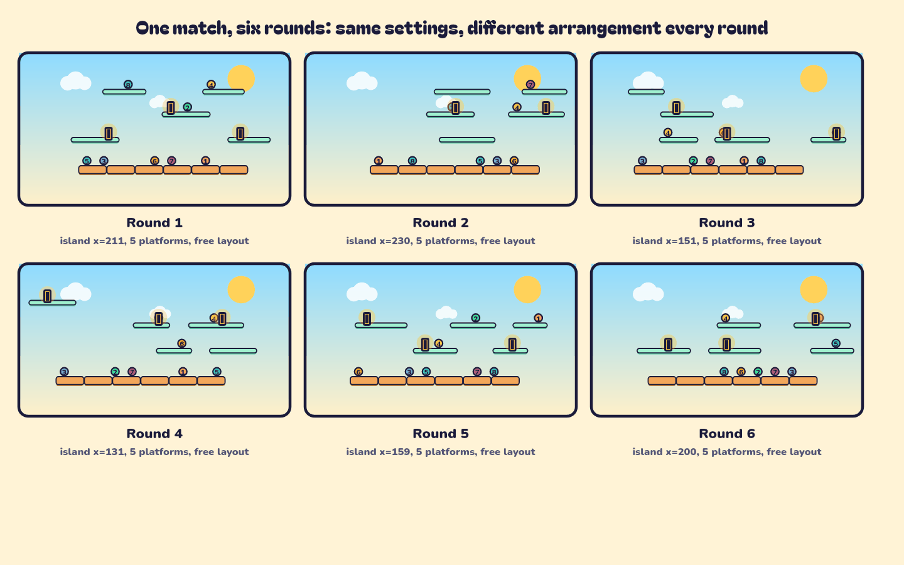
*Figure 5.1: Same match, six different rounds. Numbered dots are spawn spots, stars are power spots. These were produced by the reference code in section 13.1.*

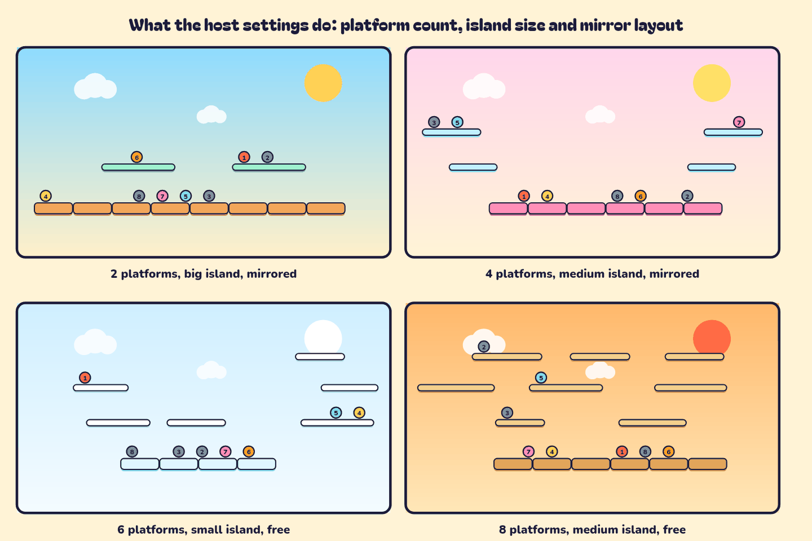
*Figure 5.2: Host settings change the arena: 2, 4, 6 and 8 platforms, small and big island, mirrored or free layout, different themes.*

### 5.1 How the generator works

1. **Seed.** The server creates a `roomSeed` when the room is created. The round seed is `hash(roomSeed, roundNumber)`. Every device gets the same numbers and builds the identical arena, so the server only has to send the seed.
2. **Separate random streams.** Layout, spawns and power spots use different streams (`layout`, `spawn`, `power`), so changing one rule does not reshuffle everything else.
3. **Island.** Width = tiles x 100 px, centered, jitter +/- 50 px.
4. **Platforms** are placed on three height tiers above the floor (100, 190 and 270 px above it). For each platform try up to 60 random positions and accept the first that passes:
   - It does not overlap another platform on the same tier (minimum gap 40 px).
   - It is not stacked within 70 px under or over another platform that overlaps it horizontally.
   - It is **reachable**: some existing platform is within a horizontal gap of 220 px and within a climb of 130 px.
5. **Mirror mode.** Generate half the platforms on the left half and mirror them. If the count is odd, add one centered platform.
6. **Connectivity check.** Run a breadth-first search from the island over the jump graph. If any platform cannot be reached, throw the layout away and retry with the next attempt number (up to 40 times, then fall back to the classic layout).
7. **Spawns and power spots** are chosen last (section 6.2).

### 5.2 Where the constants come from

They are derived from the game physics (see 13.4):

| Number | Meaning | Derivation |
|---|---|---|
| 144 px | Height of a normal jump | 720 squared / (2 x 1800) |
| 111 px | Extra height of the double jump | (720 x 0.88) squared / (2 x 1800) |
| 130 px | Max climb used by the generator | A single jump (144) with a safety margin |
| 336 px | Horizontal distance in one jump at full speed | 420 px/s x 0.8 s air time |
| 220 px | Max horizontal gap used by the generator | The 336 above with a safety margin |

If you change gravity, jump power or speed, **recompute these constants**, or arenas may become unreachable.

### 5.3 Test result

The reference generator (section 13.1) was run for 8,400 combinations (platform count 2 to 8, mirrored and free, three island sizes, many seeds and rounds):

- Every arena was valid and fully reachable. Average attempts: 1.01. Fallbacks used: 0.
- The same seed, round and settings always gave the same arena.
- A different round number always gave a different arena.

---

## 6. Power-ups and the "first to reach" rule

**Your requirement:** "the user will get the power when they first reach there." This is the **first-touch** rule: whoever reaches a power spot first gets the crate.

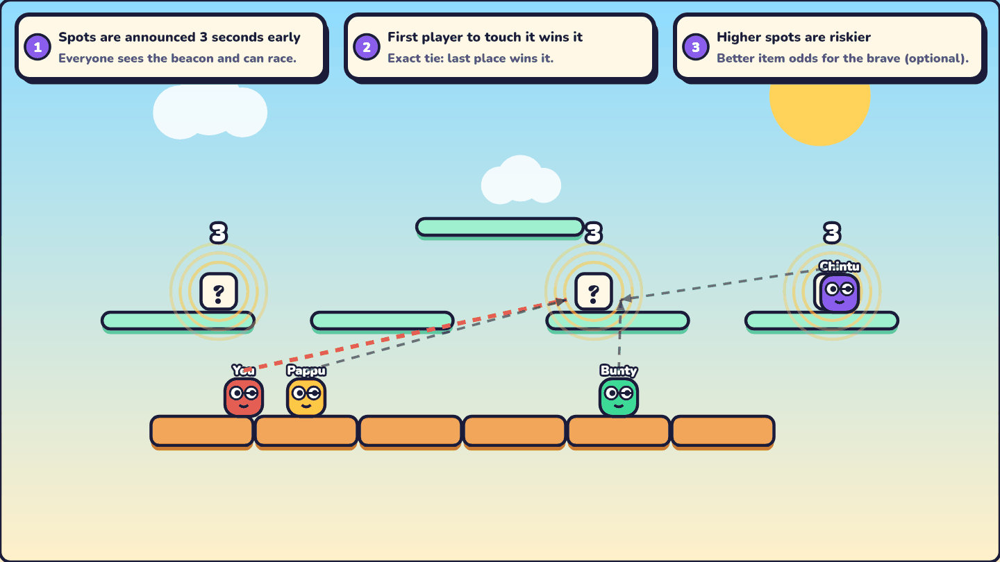
*Figure 6.1: Power spots are announced with a beacon and a 3 second countdown. Everyone races. The first player to touch gets the crate.*

### 6.1 Rules

| Rule | Detail |
|---|---|
| Spots | `items.spots` fixed spots per round (default 3). Placed on platforms, **weighted toward higher ones** so the best spots are the riskiest. |
| Announce | A beacon with a countdown "3, 2, 1" appears at the spot before the crate drops, so everyone can race. |
| Pickup | First player whose body touches the crate gets it. |
| Tie | If two players arrive in the same server tick, the one with the **lower total score** wins (comeback help). If still tied, a seeded random choice. |
| Capacity | One item per player. If you hold one, touching another crate does nothing (setting: swap them). |
| Use | Press Shove. The item is consumed. Shield is applied instantly on pickup. |
| Expiry | Crates vanish after 14 seconds if nobody takes them. Items do not carry over between rounds (unless `keepOnKO`). |
| Refill | A spot refills 6 to 9 seconds after it was taken. |

### 6.2 Fairness details

- **Server decides.** The server resolves pickups in tick order. The browser only shows a prediction.
- **Lag compensation.** Forgive up to 100 ms so a player on a slower network is not always beaten.
- **No spawn camping.** Spots are never placed within 200 px of each other, and never next to a spawn point of the same player twice in a row.
- **Optional "Summit Bonus".** The first player to land on the highest platform of the round gets a free item. Off by default.

### 6.3 Items

| Item | Icon (demo) | Effect |
|---|---|---|
| Mega Shove | 💥 | Next shove has 2.6 times the force and 1.5 times the range. |
| Freeze Burst | 🧊 | Next shove freezes everyone within 170 px for 1.4 s (they cannot move). |
| Swap | 🔀 | Next shove swaps places with the nearest rival within 460 px. |
| Shield | 🛡️ | 5 seconds with no knockback, no freeze, no bomb passing. |

Ideas for later (not built): Magnet (pulls the crown), Banana (a slippery trap), Rocket Jump, Giant (grow for 6 s), Decoy, Reverse Curse (reverses one rival's controls).

---

## 7. Themes and round-wise theme change

A **theme** changes colors, background, particles and music. It does **not** change gameplay unless the host turns on `twists.themeLinked`.

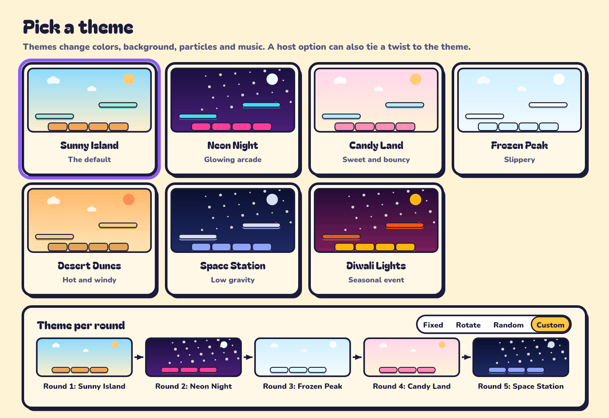
*Figure 7.1 (MOCKUP): Seven themes. Below, a "Theme per round" strip lets the host set a different theme for each round, or use Fixed, Rotate or Random.*

### 7.1 Theme modes

| Mode | Behaviour |
|---|---|
| Fixed | One theme for the whole match. |
| Rotate | Go through the themes in order, one per round. |
| Random | A random theme every round, no repeat twice in a row. |
| Custom | The host picks a theme for each round on the strip. |

### 7.2 The seven themes (all colors are hex values)

| Theme id | Name | Sky top | Sky bottom | Sun / Moon | Floor fill / edge | Platform fill / edge | Linked twist (if enabled) |
|---|---|---|---|---|---|---|---|
| `sunny` | Sunny Island | `#8EDBFF` | `#FFF0C9` | `#FFD25A` | `#F2A65A` / `#C97A2C` | `#9FF0CE` / `#5DC9A0` | none |
| `neon` | Neon Night | `#1A1040` | `#4B1F7A` | `#F5F0FF` | `#FF3D9A` / `#B0206B` | `#22E3FF` / `#0B9BB5` | Lights Out |
| `candy` | Candy Land | `#FFD6EC` | `#FFF4D6` | `#FFE066` | `#FF8FB8` / `#D9578A` | `#B8F0FF` / `#7CCBE0` | Trampoline |
| `frozen` | Frozen Peak | `#CFEFFF` | `#F4FBFF` | `#FFFFFF` | `#DFF6FF` / `#8FD0EA` | `#FFFFFF` / `#B7DDEE` | Ice Rink |
| `desert` | Desert Dunes | `#FFB86B` | `#FFE7B8` | `#FF6B3D` | `#E2A55A` / `#B97A2E` | `#F4D08C` / `#C9A04F` | Gale Force |
| `space` | Space Station | `#0B1030` | `#1F2A66` | `#D7DEFF` | `#8FA3FF` / `#4D5FD1` | `#D7DEFF` / `#8A97E6` | Moon Gravity |
| `diwali` | Diwali Lights | `#240B36` | `#7A1F5C` | `#FFB703` | `#FFB703` / `#C47F00` | `#FB5607` / `#B13A00` | none (seasonal) |

Only `sunny` exists in the demo. The other six are designed here and drawn in the mockup; the colors in the table are the ones used in Figure 7.1.

### 7.3 What a theme contains (data shape)

```json
{
  "id": "neon",
  "name": "Neon Night",
  "sky": ["#1A1040", "#4B1F7A"],
  "orb": "#F5F0FF",
  "stars": true,
  "floor": ["#FF3D9A", "#B0206B"],
  "platform": ["#22E3FF", "#0B9BB5"],
  "ink": "#1B1B3A",
  "particles": "sparkle",
  "music": "neon-loop-01",
  "linkedTwist": "dark"
}
```

### 7.4 Rules

- Keep **ink** (the dark outline) the same in every theme so the game always feels like the same game.
- Check contrast: player colors must stay readable on every sky. Test each theme with all 8 player colors.
- Seasonal themes (Diwali, Holi, an IPL-style cricket theme, college fest) are a content and revenue opportunity (section 10). Sponsored themes must be clearly marked.
- Night themes should avoid fast flashing. Cap flashes at 3 per second (accessibility, section 11).

---

## 8. Design system: fonts, colors, icons, sound, motion

**Style name: "Sticker Pop".** Thick dark outlines, hard offset shadows, rounded squircle shapes, candy-bright colors on cream paper panels. It looks like stickers on a sheet.

### 8.1 Fonts

| Role | Font | Weights used | Source and license | Where used |
|---|---|---|---|---|
| Display (titles, timer, buttons) | **Bagel Fat One** | 400 (only weight) | Google Fonts, SIL Open Font License 1.1 | Game title, round title, timer, card names, Play button |
| Body and UI | **Nunito** | 700 and 900 | Google Fonts, SIL Open Font License 1.1 | Labels, scoreboard, chips, hints, names, feed |

CSS stacks used in the demo:

```css
--font-display: "Bagel Fat One", "Arial Rounded MT Bold", system-ui, sans-serif;
--font-body:    Nunito, system-ui, -apple-system, "Segoe UI", sans-serif;
```

Type scale (in game pixels on the 960 x 540 canvas): title 58, timer 46, round title 40, banner 60, button 26, card name 21, body 16, chip 15, small 13, label 12.

**Production advice:** download the fonts and **host them yourself** as `.woff2` instead of loading from Google. It is faster, avoids a layout jump, and avoids sending visitors' IP addresses to a third party (a privacy point under European rules). Hinglish written in English letters needs only Latin glyphs. If you add Devanagari text later, add "Noto Sans Devanagari" as a fallback.

### 8.2 Color tokens (the "Sticker Pop" palette)

**Core tokens**

| Token | Name | Hex | Used for |
|---|---|---|---|
| `--mp-ink` | Ink Navy | `#1B1B3A` | All outlines, text on light panels, hard shadows |
| `--mp-paper` | Paper Cream | `#FFF8E7` | Panels and cards |
| `--mp-butter` | Butter | `#FFF3D6` | Page background (light mode) |
| `--mp-night` | Night Indigo | `#17172E` | Page background (dark mode) |
| `--mp-muted` | Slate Muted | `#55557A` | Secondary text on cream |
| `--mp-muted-page` | Page Muted | `#6A6A8A` | Hint text under the canvas |
| `--mp-sun` | Sun Yellow | `#FFC93C` | Primary buttons, selected state, "YOU" marker |
| `--mp-mint` | Mint | `#3DDC97` | On / success / ready |
| `--mp-coral` | Coral | `#FF6B6B` | Danger, out, red states |
| `--mp-grape` | Grape | `#8B5CF6` | Badges, focus ring |
| `--mp-aqua` | Aqua | `#4CC9F0` | Player color, ice accents |
| `--mp-danger` | Danger Red | `#FF4D4D` | High damage text, bomb ring |
| `--mp-ok` | Success Green | `#2A9D6A` | Points gained text |
| `--mp-shield` | Shield Blue | `#7DD3FC` | Shield bubble |
| `--mp-gold-glow` | Crown Glow | `rgba(255,201,60,.35)` | Crown glow |

**Player colors** (index 0 is always the local player in the demo)

| # | Name | Hex |
|---|---|---|
| 0 | Coral | `#FF6B6B` |
| 1 | Mint | `#3DDC97` |
| 2 | Grape | `#8B5CF6` |
| 3 | Sun Yellow | `#FFC93C` |
| 4 | Aqua | `#4CC9F0` |
| 5 | Orange | `#FF9F1C` |
| 6 | Pink | `#F15BB5` |
| 7 | Teal | `#2EC4B6` |

**World colors (Sunny Island theme)**

| Element | Fill | Edge |
|---|---|---|
| Island floor tile | `#F2A65A` | `#C97A2C` |
| Floating platform | `#9FF0CE` | `#5DC9A0` |
| Ice floor (Ice Rink twist) | `#C8F0FF` | `#8FD0EA` |
| Ice platform | `#D7F5FF` | `#8FD0EA` |
| Trampoline floor | `#FF9DBB` | `#E0668C` |
| About-to-fall tile (blinks) | `#FF6B6B` | n/a |
| Sky gradient | `#8EDBFF` to `#FFF0C9` | n/a |
| Danger glow at screen bottom | `rgba(255,107,107,0)` to `rgba(255,107,107,.45)` | n/a |

**Damage color ramp:** under 30 percent white, 30 to 60 percent orange `#FF9F1C`, above 60 percent red `#FF4D4D`. (Color alone is not enough for color-blind players, so the number is always shown too.)

**Ready-to-paste CSS variables**

```css
:root {
  --mp-ink:#1B1B3A; --mp-paper:#FFF8E7; --mp-butter:#FFF3D6; --mp-night:#17172E;
  --mp-muted:#55557A; --mp-sun:#FFC93C; --mp-mint:#3DDC97; --mp-coral:#FF6B6B;
  --mp-grape:#8B5CF6; --mp-aqua:#4CC9F0; --mp-danger:#FF4D4D; --mp-ok:#2A9D6A;
  --mp-shield:#7DD3FC;
  --mp-outline:3px; --mp-radius-panel:18px; --mp-radius-chip:14px; --mp-shadow:6px 7px 0 var(--mp-ink);
}
```

### 8.3 Icons

**What the demo uses today:** Unicode emoji drawn by the phone or computer's own emoji font (Apple Color Emoji, Noto Color Emoji, Segoe UI Emoji). It needs no files, but **the same emoji looks different on each device** and a few older phones show empty boxes.

| Where | Icon | Meaning |
|---|---|---|
| Modes | 🥊 💣 👑 | Last One Standing, Bomb Tag, Crown Rush |
| Power-ups | 💥 🧊 🔀 🛡️ | Mega Shove, Freeze Burst, Swap, Shield |
| Twists | 🌙 ⚓ 🐭 🦣 🎲 🙃 🧊 ⚡ 🐦 🕳️ 💨 🔦 🦘 | Moon Gravity, Heavy Boots, Tiny Tots, Big Boys, Size Lottery, Reversed Controls, Ice Rink, Turbo, Flappy Mode, Crumbling Floor, Gale Force, Lights Out, Trampoline |
| Lobby | 👑 🤖 🎲 | Host, Bot, Random name |

**Recommended production icon packages** (check the license text before shipping):

| Use | Package | License (as far as we know) | Why |
|---|---|---|---|
| Game icons that look the same on every device | **Noto Emoji** (Google) or **Twemoji** as SVG/PNG sprites | Noto Emoji: Apache 2.0 / OFL. Twemoji graphics: CC BY 4.0 (needs attribution) | Same look everywhere. |
| UI controls (settings, copy, share, close, kick, volume, check) | **Lucide** icons (`lucide` or `lucide-static` on npm) | ISC | Clean, consistent outline icons, tiny SVGs. |
| Flutter version (if you ever port) | `lucide_icons` package | ISC (verify) | Same set. |

If Lucide has a matching icon for a game concept, prefer it for menus (for example bomb, crown, shield, snowflake, shuffle, moon, wind, anchor, zap). Confirm exact icon names on the Lucide website before coding.

**Game art:** everything inside the arena (platforms, players, crates, rings) is drawn with code on the canvas. There are **no image files** in the demo, which keeps it tiny (about 50 KB) and fast.

### 8.4 Sound

- **Today:** synthesized with the browser's Web Audio API (square, triangle, sawtooth beeps). No audio files.
- **Rules:** sound starts only after the first tap or key press (browsers require it). Mute on `M` and a visible mute button. Remember the mute choice.
- **Production:** add a small sound pack. Kenney.nl audio packs are CC0 (free for any use, but verify each pack). Add one looping music track per theme, quiet by default.

### 8.5 Shape, spacing and motion tokens

| Token | Value |
|---|---|
| Outline | 3 to 4 px Ink Navy on every shape |
| Hard shadow | offset (6 px, 7 px), solid Ink Navy, no blur |
| Panel radius | 18 px |
| Chip radius | 14 px (pill) |
| Button | full pill (radius = half height), 4 px outline |
| Player body | squircle, corner radius 32 percent of size, base size 36 px (hs 18) |
| Canvas | logical 960 x 540 (16:9), device pixel ratio capped at 2 |
| Page border | 3 px Ink Navy, radius 14 px |
| Pulse | scale 1 plus or minus 0.04 at about 5 Hz (Play button) |
| Title wave | each letter bobs 6 px, off when "reduce motion" is on |
| Hit-stop | 70 ms freeze on a hit (120 ms for Mega Shove) |
| Slow motion | 25 percent speed on the final knockout, back to normal in about half a second |
| Screen shake | 5 to 18 px, decays quickly |

### 8.6 HUD map

Top-left: round number and mode chip. Top-center: timer and twist chips. Top-right: scoreboard (round totals, or crown seconds in Crown Rush). Left, below the mode chip: the event feed (last 4 lines, fade after 2.6 s). Over each player: name and damage percent, plus an icon for bomb, crown or held item. The local player has a yellow arrow.

---

## 9. Technical architecture

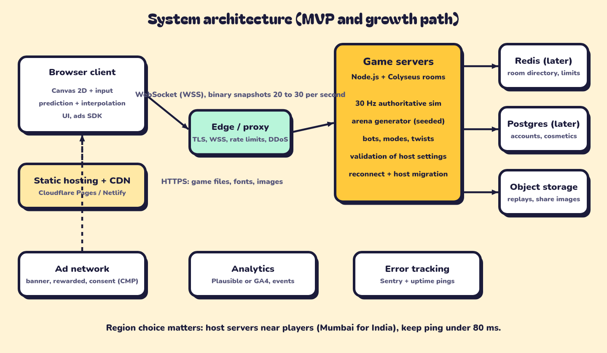
*Figure 9.1: Architecture for the MVP, with later additions marked "later".*

### 9.1 Recommended stack

| Layer | Choice | Reason |
|---|---|---|
| Client | Keep vanilla **Canvas 2D** (what the demo uses). Optional: Phaser 3 if you want sprite tools. | The demo already works. No framework needed. |
| Server | **Node.js 22 + Colyseus** (rooms, state sync, reconnection built in) | Fast to build in JavaScript, the same language as the client. Alternative: plain `ws` plus your own room code. |
| Static files | Cloudflare Pages, Netlify or Vercel | Free tiers, global CDN. |
| Game servers | Fly.io, Railway or a small VPS | Pick a region near players (Mumbai for India). Verify current region list and prices. |
| Later | Redis for room directory and rate limits. Postgres (for example Supabase) for accounts and cosmetics. | Not needed for the MVP. |
| Monitoring | Sentry (errors), Plausible or GA4 (events), an uptime ping | You must see problems before players complain. |

### 9.2 How the game stays fair and in sync

| Topic | Decision |
|---|---|
| Who runs the physics? | The **server**. It is the only source of truth (this stops cheating). |
| Tick rate | Simulation at 30 Hz. Send snapshots 20 to 30 times a second. |
| Local player | Client-side prediction: move instantly on your screen, correct if the server disagrees. |
| Other players | Draw them about 100 ms in the past and interpolate between two snapshots, so movement is smooth. |
| Arena | Send only the **seed**. Every client builds the same arena (section 5). |
| Cosmetic effects | Screen shake, hit-stop and slow motion are client-only visuals. Do not slow the server. |
| Round state | A server state machine: lobby, intro, pick, play, results, final. |
| Bots | Run on the server using the same input format as humans. |
| Random numbers | Server-side `Math.random` only for gameplay events. Seeded generators for arenas. |

### 9.3 Messages (summary)

| Direction | Message | Content |
|---|---|---|
| Client to server | `join` | roomCode, name, color, playerId, sessionToken |
| Client to server | `input` | left, right, jump, shove as a small bitfield plus sequence number |
| Client to server | `settings:update` | host only, whole or partial settings object |
| Client to server | `ready`, `start`, `pick`, `vote`, `emote`, `kick` | small actions |
| Server to client | `state` | snapshot: positions, velocities, timers, items, bomb and crown |
| Server to client | `event` | KO, bomb pass, crown steal, pickup, toast text |
| Server to client | `round:start` | mode, twists, theme, seed, spawn slot for you |
| Server to client | `settings` | the validated settings |
| Server to client | `error` | human-readable reason (room full, wrong code, banned) |

### 9.4 Rough capacity math

One snapshot is 8 players x about 16 bytes = about 130 bytes, 30 times a second = about 4 KB/s per player. A full room of 8 receives about 4 KB/s each, so about 31 KB/s per room going out. That is tiny. The limit is more likely CPU for physics and bots than bandwidth, so **measure** with a load test before promising numbers (section 13.8).

### 9.5 Security basics

- Server decides everything. Validate and clamp every input (speed, rate of actions).
- Room codes: 5 characters from 31 symbols is about 28.6 million codes. Rate-limit join attempts per IP and expire empty rooms quickly.
- Passwords stored only in memory for the life of the room.
- HTTPS and WSS only. Check the `Origin` header on WebSocket connections.
- Cap rooms per IP to stop room spam.

---

## 10. How to make money

**Golden rule:** never put ads over gameplay. A player who loses a fight because of a pop-up leaves forever. Show ads only in menus, lobby and between matches. Protect trust first, earn second.

### 10.1 Where ads go

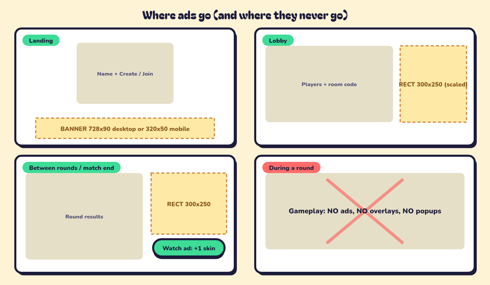
*Figure 10.1: Ad slots on landing, lobby and results. Never during a round.*

| Screen | Ad type | Size | Notes |
|---|---|---|---|
| Landing | Banner | 728x90 desktop, 320x50 mobile | Below the name box. Never next to the Play or Create button (accidental clicks are against ad rules). |
| Lobby | Rectangle | 300x250 (scaled) | Side column while people wait. |
| Between rounds | Rectangle | 300x250 | Only on the results panel. |
| Match end | Interstitial | full screen | Maximum one per 8 to 10 minutes. Never in the first session. Always after a full match. |
| Anywhere | Rewarded video | opt-in | "Watch an ad to unlock a skin for 1 day." The player chooses. |
| During a round | **None** | | No ads, no overlays, no pop-ups. |

### 10.2 Ad networks and platforms (verify current terms)

| Option | What it is | Notes |
|---|---|---|
| Google AdSense / Ad Manager | Banner and display ads on your website | Needs real content pages (how to play, news, FAQ) to be approved. A single game screen can be rejected as thin content. Follow the placement policies. |
| Google H5 Games Ads (Ad Placement API) | Interstitial and rewarded ads made for browser games | Needs approval. Check eligibility. |
| Game portals (CrazyGames, Poki, GameDistribution and similar) | They host your game and share ad revenue | You get their audience but give up part of the revenue and need to follow their rules, including for online multiplayer. Check each portal's terms. |
| Mobile app route (AdMob) | If you wrap the game as an Android app | More work, higher reach on phones. |
| Ad mediation (for example AppLovin or similar) | Several networks compete for each impression | Raises earnings once you have steady traffic. |

### 10.3 Other income

| Idea | How | Notes |
|---|---|---|
| Cosmetics | Skins, hats, trails, victory poses, emote packs | The best long-term income. Never sell power. |
| Season pass | A monthly reward track | Needs accounts. Later. |
| Host Pro | Subscription: bigger rooms (16+), custom themes, no ads, private tournaments | Good for teachers, streamers, colleges. |
| Sponsored themes and crates | A brand skins a theme or a crate for a campaign, for example a cricket league, a snack brand, a college fest | Label clearly as sponsored. |
| College and fest rooms | Branded leaderboard, event codes | Fits a student audience. |
| Tips | UPI QR code, "Buy me a coffee" | Small but easy. |
| Merch | Stickers (the style suits it) | Later. |
| Creator code | Streamers get a code to share, you share revenue | Growth plus income. |

**India notes:** UPI is the payment people already use. Payment gateways such as Razorpay or Cashfree support it. Talk to a chartered accountant about GST and income tax on digital income before you take money.

### 10.4 What revenue can look like (illustrative only)

The numbers below are **assumptions, not predictions**. Real eCPM (earnings per 1,000 views) varies a lot by country, time of year, device and ad network. Replace them with numbers from your own ad dashboard after a few weeks.

**Formula**

```
Banner and rectangle revenue / month = DAU x sessions per day x ad views per session x eCPM / 1000 x 30
Rewarded revenue / month             = DAU x rewarded views per user per day x rewarded eCPM / 1000 x 30
Cosmetics / month                    = DAU x 4 (to estimate monthly users) x paying share x average spend
```

**Assumptions used:** 2.5 sessions per user per day, 6 ad views per session, 0.3 rewarded views per user per day, monthly users = 4 x daily users, 0.5 percent of monthly users pay, average spend 2 USD per month.

| Scenario | Daily users | Banner eCPM | Rewarded eCPM | Banner / month | Rewarded / month | Cosmetics / month | Total / month |
|---|---|---|---|---|---|---|---|
| Low | 1,000 | 0.30 USD | 4 USD | about 135 USD | about 36 USD | about 40 USD | about 211 USD |
| Base | 10,000 | 0.80 USD | 8 USD | about 3,600 USD | about 720 USD | about 400 USD | about 4,720 USD |
| High | 50,000 | 2.00 USD | 15 USD | about 45,000 USD | about 6,750 USD | about 2,000 USD | about 53,750 USD |

**Reality check:** reaching 10,000 daily users is hard and takes months of growth work. Hosting is small at first (roughly tens of dollars a month at the low end, more as rooms grow; measure). The honest early goal is **retention and word of mouth**, not revenue. Add ads only once players come back on day 7.

### 10.5 What not to do

- No ads inside gameplay, no fake "close" buttons, no ads that look like game buttons.
- No selling power-ups that win matches (pay-to-win kills rooms with friends).
- No collecting personal data you do not need.
- No ads shown to players you believe are children without checking the network's child-directed rules (section 11.1).

---

## 11. Things you may have forgotten (care checklist)

Labels: **MUST** = before any public launch. **SHOULD** = before real growth. **LATER** = after traction.

### 11.1 Legal, privacy and safety

| Level | Item | Notes |
|---|---|---|
| MUST | Privacy Policy and Terms of Use pages | Required by ad networks and app stores. Say what you collect (name, IP, cookies, analytics). |
| MUST | Children and teenagers | Many players are under 18. India's Digital Personal Data Protection Act, 2023 treats under-18s as children and restricts tracking and targeted ads for them (the rules are being phased in; confirm the current status with a lawyer). The US has COPPA (under 13) and Europe has GDPR rules. Safest design: no accounts, no personal data, **non-personalized (contextual) ads** and the ad network's child-directed or "under age of consent" tags where required. |
| MUST | Cookie and ad consent for Europe | Use a Google-certified consent tool (CMP) if you serve ads to EU or UK visitors. |
| MUST | Moderation of names and room names | Server-side filter, report button, host kick. |
| MUST | No free-text chat at launch | Use emotes only. Free chat needs moderation, reporting and more legal work. |
| MUST | Name and trademark check | "Mutator Party" must not clash with existing games. Search the Indian trademark registry and the web. Do not use "Skribbl" or "Smash Karts" or look-alike art. |
| MUST | Asset licenses | Fonts are OFL (fine). Emoji packs may need attribution (Twemoji CC BY). Keep a `CREDITS` page. |
| MUST | Employment and IP | If you work or are about to work for a games or tech company, read the outside-work and IP clauses in your contract **before** launching a commercial game. Get written permission if needed. |
| SHOULD | Grievance and contact e-mail | A visible address for complaints, takedowns and parents. |
| SHOULD | Age notice | A plain line such as "Meant for players 13 and over" with parental guidance wording reviewed by a lawyer. |
| SHOULD | Company or registration | Decide how income will be received and taxed (talk to a chartered accountant). |
| LATER | Accounts | Add Google or phone sign-in only when you sell cosmetics. Then data protection duties grow. |

### 11.2 Technical

| Level | Item | Notes |
|---|---|---|
| MUST | Use `event.code` for movement keys | Letters differ on non-QWERTY keyboards. `KeyA`, `KeyD`, `KeyW` are position-based. |
| MUST | Pause or throttle in background tabs | Browsers slow hidden tabs. The server must never depend on client timers. |
| MUST | Phone support | Landscape layout, safe-area padding, big touch buttons (at least 48 px), multi-touch for move plus jump, no text selection, no pull-to-refresh. |
| MUST | Audio unlock | Start sound after the first tap (Safari and Chrome rules). |
| MUST | Server validation | Clamp every host setting and every input (section 13.3). |
| MUST | Reconnect | 30 second grace, bot takes over (section 3.3). |
| MUST | Performance budget | Stable 60 fps on a cheap Android phone. Cap particles (for example 300), keep draw calls low, cap device pixel ratio at 2. |
| SHOULD | Offline and install | Make it a PWA (installable, cached files). |
| SHOULD | Share cards | Open Graph image and title so links look good in WhatsApp, Discord and X. |
| SHOULD | Error tracking | Sentry or similar from day one. |
| SHOULD | Versioning | Version the settings object and the network protocol. A deploy must not crash live rooms (drain old rooms, then restart). |
| SHOULD | Time and clock | Show server-provided countdowns. Never trust the player's clock. |
| LATER | Gamepad support | Standard Gamepad API. |
| LATER | Replays and clips | Record the last 8 seconds of events and export a short video. |

### 11.3 Gameplay and fairness

| Level | Item | Notes |
|---|---|---|
| MUST | Fix round length | See 2.4. Rounds must last 40 to 75 seconds. |
| MUST | Tie-breaks | Define what happens for ties in points, in crown seconds and at time up. |
| MUST | Anti-snowball and comeback | Last place picks the twist (done). Consider slightly stronger first-touch priority for last place. |
| MUST | Banned twist combinations | Test all 13 twists in pairs and triples. Remove or limit unfun mixes (for example Flappy plus Moon Gravity may be too floaty, Heavy plus Crumbling may be too punishing). |
| MUST | Spawn fairness | Mirrored layouts or equal-distance spawns so no one is boxed in. |
| SHOULD | Tutorial | A 20 second first-time practice with one bot. |
| SHOULD | Sudden death | If the timer ends with many players alive, shrink the arena. |
| SHOULD | Spectators | People who are out can watch and send emotes. |
| SHOULD | AFK handling | Section 3.3. |
| LATER | Teams | 2 vs 2 and 4 vs 4 modes. |
| LATER | Hazards | Section 13.2. |

### 11.4 Accessibility

| Level | Item | Notes |
|---|---|---|
| MUST | Do not rely on color alone | Players also have names and different color shapes or hats. Damage shows a number. |
| MUST | Reduce motion option | Turns off title wave, shake, slow motion and big particle bursts. |
| MUST | Flash safety | No more than 3 flashes per second. Review Lights Out and explosions. |
| SHOULD | Rebindable keys, one-handed touch layout | |
| SHOULD | Text size | Minimum 12 px on the canvas, scalable. |
| SHOULD | Subtitles for sound cues | A visual cue for every important sound (bomb ticking, crate spawn). |
| SHOULD | Screen reader labels | For all menu buttons and form fields (the canvas itself cannot be read). |

### 11.5 Growth, analytics and operations

| Level | Item | Notes |
|---|---|---|
| MUST | One-tap invite | Copy link and WhatsApp share. Most Indian groups already live in WhatsApp. |
| MUST | Events to track | `room_created`, `player_joined`, `match_started`, `match_finished`, `round_length`, `ad_viewed`, `share_clicked`, `rage_quit`. |
| SHOULD | Key numbers | Day 1 and day 7 return rate, average session length, rounds per session, invites per player, how full rooms get. |
| SHOULD | Feedback button | A form or link on the results screen. |
| SHOULD | Community | A Discord or WhatsApp community for testers. |
| SHOULD | Launch channels | Your own Hinglish tech channel (Tech Pulse) for devlogs and launch posts, college groups and fests, Reddit communities for browser games, short vertical clips of knockouts. |
| SHOULD | Landing page content | A "How to play" page, FAQ and patch notes. Helps SEO and ad approval. |
| SHOULD | Cost alerts | Budget alerts on hosting. |
| LATER | A/B tests | For ad placement and onboarding. |
| LATER | Localization | Hinglish and Hindi text packs. |

---

## 12. Roadmap and effort

Estimates assume one developer working about 10 to 12 hours a week. They are rough and should be revisited after the first milestone.

| Milestone | Goal | Main tasks | Estimate |
|---|---|---|---|
| M0 (done) | Offline demo v2 | 3 modes, 13 twists, items, pick screen, bots. | done |
| M0.5 | Fix feel | Tune knockback, bots, bomb pass. Hit the round length targets. Switch keys to `event.code`. | 1 week |
| M1 | Online MVP | Name prompt, rooms and codes, lobby, server physics, 3 modes, seeded random arenas, reconnect, bots on server. | 5 to 7 weeks |
| M2 | Host controls and polish | Full settings screen, validation, presets, themes (3 first), power spots with first-touch, mobile controls, tutorial. | 4 to 6 weeks |
| M3 | Public beta | Analytics, error tracking, privacy and terms pages, moderation tools, share cards, banner ads on landing and lobby, WhatsApp share. | 3 to 4 weeks |
| M4 | Retention | Cosmetics, rewarded ads, more themes (including seasonal), hazards, more modes, streamer tools. | ongoing |

**Definition of done for M1:** 4 friends on 4 phones can join one room by link, finish 5 rounds with no desync, and any one of them can drop and rejoin.

**Biggest risks**

| Risk | Plan |
|---|---|
| Netcode feels laggy on mobile networks | Deploy near players, prediction plus interpolation, show ping, test on throttled networks early. |
| Nobody finds the game | Build the share loop first (link, WhatsApp, clips) and use your own channel for launch. |
| Rounds are not fun | Playtest every week with real people. Keep a list of fun and not-fun moments. |
| Moderation or legal trouble | Emotes only, no accounts, strict name filter, privacy-first. |
| Scope growth | Ship M1 before adding hazards, teams or cosmetics. |

---

## 13. Appendices

### 13.1 Reference code: arena generator (single file, copy-paste ready)

Save as `arena.js`. It has no dependencies and works in Node and in the browser. It was tested on 8,400 setting combinations (section 5.3).

```javascript
/* arena.js - deterministic per-round arena generator (reference implementation, no dependencies).
   Same (seed, round, settings) => same arena on every client and on the server. */
function mulberry32(a){ return function(){ a |= 0; a = a + 0x6D2B79F5 | 0; let t = Math.imul(a ^ a >>> 15, 1 | a);
  t = t + Math.imul(t ^ t >>> 7, 61 | t) ^ t; return ((t ^ t >>> 14) >>> 0) / 4294967296; }; }
function hashSeed(...parts){ let h = 2166136261 >>> 0; for (const c of parts.join('|')){ h ^= c.charCodeAt(0); h = Math.imul(h, 16777619); } return h >>> 0; }

const ARENA = { W:960, H:540, FLOOR_Y:400, TILE_W:100, TIERS:[300, 210, 130],
  MAX_STEP_UP:130,   // single jump apex is ~144px; keep a safety margin
  MAX_GAP:220,       // air time ~0.8s * 420px/s = ~336px; keep a safety margin
  MIN_W:120, MAX_W:200, MIN_SEP:40 };

function generateArena({ seed, round = 0, platformCount = 4, islandTiles = 6, symmetric = true, players = 8, powerSpots = 3 }){
  for (let attempt = 0; attempt < 40; attempt++){
    const rnd = mulberry32(hashSeed(seed, round, 'layout', attempt));
    const R = (a, b) => a + rnd() * (b - a);
    const A = ARENA, isl = { w:islandTiles * A.TILE_W, y:A.FLOOR_Y };
    isl.x = Math.round(A.W / 2 - isl.w / 2 + R(-50, 50));
    const plats = [], all = () => [isl, ...plats];
    const overlapX = (a, b, pad = 0) => a.x < b.x + b.w + pad && b.x < a.x + a.w + pad;
    const gapX = (a, b) => Math.max(0, Math.max(a.x - (b.x + b.w), b.x - (a.x + a.w)));
    const ok = c => {
      for (const p of all()) if (p.y === c.y && overlapX(c, p, A.MIN_SEP)) return false;
      for (const p of all()) if (overlapX(c, p) && Math.abs(p.y - c.y) < 70) return false;
      return all().some(p => gapX(c, p) <= A.MAX_GAP && (p.y - c.y) <= A.MAX_STEP_UP);
    };
    const want = symmetric ? Math.floor(platformCount / 2) : platformCount;
    for (let i = 0; i < want; i++){
      for (let tries = 0; tries < 60; tries++){
        const r = rnd(), tier = r < .45 ? 0 : r < .85 ? 1 : 2, w = Math.round(R(A.MIN_W, A.MAX_W));
        const maxX = symmetric ? A.W / 2 - 20 - w : A.W - 30 - w;
        const c = { x:Math.round(R(30, Math.max(31, maxX))), y:A.TIERS[tier], w };
        if (ok(c)){ plats.push(c); if (symmetric) plats.push({ x:A.W - c.x - c.w, y:c.y, w:c.w }); break; }
      }
    }
    if (symmetric && platformCount % 2){ const w = 160; plats.push({ x:A.W / 2 - w / 2, y:A.TIERS[1], w }); }
    // validate: every platform reachable from the island (BFS over the jump graph)
    const seen = new Set([isl]), q = [isl];
    while (q.length){ const a = q.shift(); for (const b of all()){ if (seen.has(b)) continue;
      const up = a.y - b.y, can = (gapX(a, b) <= A.MAX_GAP && up <= A.MAX_STEP_UP) || (gapX(a, b) <= A.MAX_GAP && up < 0 && Math.abs(up) <= 400);
      if (can){ seen.add(b); q.push(b); } } }
    if (plats.length !== platformCount || seen.size !== all().length) continue;
    // spawns: ~60% on the island, rest on platforms, then shuffled so slot -> player changes every round
    const srnd = mulberry32(hashSeed(seed, round, 'spawn'));
    const shuffle = arr => { for (let i = arr.length - 1; i > 0; i--){ const j = Math.floor(srnd() * (i + 1)); [arr[i], arr[j]] = [arr[j], arr[i]]; } return arr; };
    const spots = [];
    for (const p of all()) for (let x = p.x + 30; x <= p.x + p.w - 30; x += 60) spots.push({ x, y:p.y - 18, onIsland:p === isl });
    const isle = shuffle(spots.filter(s => s.onIsland)), top = shuffle(spots.filter(s => !s.onIsland));
    const nIsle = Math.min(isle.length, Math.ceil(players * .6)), spawns = shuffle([...isle.slice(0, nIsle), ...top].slice(0, players));
    // power spots: favour higher (harder to reach) platforms, keep them apart
    const prnd = mulberry32(hashSeed(seed, round, 'power')), spotsOut = [];
    const cand = plats.length ? plats : [isl];
    for (let k = 0; k < powerSpots * 12 && spotsOut.length < powerSpots; k++){
      const p = cand[Math.floor(prnd() * cand.length)], wgt = 1 + (A.FLOOR_Y - p.y) / 100;
      if (prnd() * 3.5 > wgt) continue;
      const s = { x:Math.round(p.x + 30 + prnd() * (p.w - 60)), y:p.y - 20 };
      if (spotsOut.every(o => Math.hypot(o.x - s.x, o.y - s.y) > 200)) spotsOut.push(s);
    }
    return { seed, round, island:{ x:isl.x, y:isl.y, w:isl.w, tiles:islandTiles }, platforms:plats, spawns, powerSpots:spotsOut, attempts:attempt + 1 };
  }
  // fallback: classic layout (never fails)
  return { seed, round, island:{ x:180, y:400, w:600, tiles:6 }, platforms:[{ x:50, y:290, w:190 }, { x:720, y:290, w:190 }, { x:385, y:195, w:190 }].slice(0, platformCount),
    spawns:Array.from({ length:players }, (_, i) => ({ x:210 + i * 77, y:382 })), powerSpots:[{ x:480, y:175 }], attempts:41, fallback:true };
}
if (typeof module !== 'undefined') module.exports = { generateArena, mulberry32, hashSeed, ARENA };
```

**Quick use:**

```javascript
const { generateArena } = require('./arena');
const arena = generateArena({ seed: 2024, round: 2, platformCount: 5, islandTiles: 6, symmetric: true, players: 8, powerSpots: 3 });
console.log(arena.island, arena.platforms.length, arena.spawns.length, arena.powerSpots);
```

### 13.2 Twist and hazard catalog

**Twists in the demo (13)**

| Id | Name | Category | Effect (exact values from the code) |
|---|---|---|---|
| `low` | Moon Gravity | gravity | Gravity x0.33, jump power x0.78 |
| `heavy` | Heavy Boots | gravity | Gravity x1.7, jump power x1.2 |
| `tiny` | Tiny Tots | size | Everyone scale 0.55 |
| `giant` | Big Boys | size | Everyone scale 1.7 |
| `lotto` | Size Lottery | size | Each player gets a random scale 0.5 to 1.8 |
| `reverse` | Reversed Controls | controls | Left and right swapped (bots too) |
| `ice` | Ice Rink | controls | Acceleration 420, braking 110 (almost no grip) |
| `speed` | Turbo | controls | Top speed x1.55 |
| `flap` | Flappy Mode | jumping | Unlimited air jumps (each at 88 percent power) |
| `crumble` | Crumbling Floor | world | Island tiles fall: first after 4 s, then every 3.2 s |
| `wind` | Gale Force | world | A constant drift of 170 px/s that changes direction every 2.5 to 4 s |
| `dark` | Lights Out | world | Screen is dark. Light circles of radius 120 around players (170 for you) |
| `bounce` | Trampoline Land | world | Landing faster than 260 px/s bounces you back at 80 percent speed |

Rule: only one twist per category per round.

**Hazards (PLANNED, none built yet)**

| Id | Name | Effect | Build difficulty | Safety or fairness note |
|---|---|---|---|---|
| `bumper` | Bumpers | Round pads that bounce players | Easy | Place away from spawns. |
| `spikes` | Spike strips | Removes a life on touch (or knockback) | Medium | Never under a spawn point. |
| `mover` | Moving platforms | Platforms slide left and right | Medium | Predictable loop, show the path. |
| `lava` | Rising lava | A kill zone slowly rises | Medium | Good sudden-death tool. |
| `meteor` | Meteor shower | Warned circles then impacts | Medium | 1 second warning ring. |
| `portal` | Portals | Two linked doors | Medium | Cooldown to avoid loops. |
| `conveyor` | Conveyor floor | A belt pushes players | Easy | Show arrows. |
| `shrink` | Shrinking arena | The island loses a tile every few seconds | Easy | Already half built (crumble). |

### 13.3 Reference code: room settings defaults and server validation (single file)

Save as `settings.js`. The server runs `sanitize()` on every host change.

```javascript
/* settings.js - room settings: defaults + server-side validation (reference implementation, no dependencies).
   Never trust the client: the server runs sanitize() on every settings:update from the host. */
const MODES = ['brawl', 'bomb', 'crown'];
const TWISTS = ['low','heavy','tiny','giant','lotto','reverse','ice','speed','flap','crumble','wind','dark','bounce'];
const ITEMS = ['mega', 'freeze', 'swap', 'shield'];
const THEMES = ['sunny','neon','candy','frozen','desert','space','diwali'];
const DEFAULTS = {
  version: 1,
  room:   { name:'', visibility:'private', password:'', chat:'emotes', spectators:true },
  match:  { maxPlayers:8, fillBots:true, botSkill:'normal', rounds:5, roundTime:'auto', scoring:'standard' },
  arena:  { platformCount:4, islandSize:'M', layout:'every_round', mirror:true, shuffleSpawns:true },
  modes:  { pool:[...MODES], order:'shuffle_bag', fixedList:[], twistPicker:'last_place' },
  twists: { allowed:[...TWISTS], perRound:'ramp', themeLinked:false },
  respawn:{ mode:'lives', lives:3, delaySec:2, shieldSec:1.5 },
  items:  { enabled:true, allowed:[...ITEMS], spots:3, firstTouch:true, keepOnKO:false },
  theme:  { mode:'rotate', fixed:'sunny', perRound:[] },
};
const clamp = (v, a, b, d) => (Number.isFinite(+v) ? Math.min(b, Math.max(a, +v)) : d);
const oneOf = (v, list, d) => (list.includes(v) ? v : d);
const subset = (arr, list, d) => { const a = Array.isArray(arr) ? [...new Set(arr.filter(x => list.includes(x)))] : []; return a.length ? a : d.slice(); };
function sanitize(input = {}, base = DEFAULTS){
  const i = input, o = JSON.parse(JSON.stringify(base)), g = k => (i[k] && typeof i[k] === 'object' ? i[k] : {});
  const r = g('room'), m = g('match'), a = g('arena'), md = g('modes'), t = g('twists'), rs = g('respawn'), it = g('items'), th = g('theme');
  o.room.name = String(r.name ?? o.room.name).replace(/[^\p{L}\p{N} _'-]/gu, '').trim().slice(0, 24);
  o.room.visibility = oneOf(r.visibility, ['private', 'public'], o.room.visibility);
  o.room.password = String(r.password ?? '').slice(0, 12);
  o.room.chat = oneOf(r.chat, ['off', 'emotes', 'filtered'], o.room.chat);
  o.room.spectators = r.spectators !== false;
  o.match.maxPlayers = clamp(m.maxPlayers, 2, 12, 8);
  o.match.fillBots = m.fillBots !== false;
  o.match.botSkill = oneOf(m.botSkill, ['easy', 'normal', 'hard'], 'normal');
  o.match.rounds = clamp(m.rounds, 1, 15, 5);
  o.match.roundTime = m.roundTime === 'auto' || m.roundTime == null ? 'auto' : clamp(m.roundTime, 30, 120, 'auto');
  o.match.scoring = oneOf(m.scoring, ['standard', 'winner_plus', 'kills'], 'standard');
  o.arena.platformCount = Math.round(clamp(a.platformCount, 2, 8, 4));
  o.arena.islandSize = oneOf(a.islandSize, ['S', 'M', 'L'], 'M');
  o.arena.layout = oneOf(a.layout, ['every_round', 'per_match', 'classic'], 'every_round');
  o.arena.mirror = a.mirror !== false;
  o.arena.shuffleSpawns = a.shuffleSpawns !== false;
  o.modes.pool = subset(md.pool, MODES, MODES);
  o.modes.order = oneOf(md.order, ['shuffle_bag', 'random', 'fixed'], 'shuffle_bag');
  o.modes.fixedList = Array.isArray(md.fixedList) ? md.fixedList.filter(x => MODES.includes(x)).slice(0, 15) : [];
  o.modes.twistPicker = oneOf(md.twistPicker, ['last_place', 'vote', 'host', 'random', 'round_robin'], 'last_place');
  o.twists.allowed = Array.isArray(t.allowed) ? [...new Set(t.allowed.filter(x => TWISTS.includes(x)))] : TWISTS.slice(); // empty = no twists, allowed
  o.twists.perRound = oneOf(t.perRound, ['1', '2', '3', 'ramp'], 'ramp');
  o.twists.themeLinked = t.themeLinked === true;
  o.respawn.mode = oneOf(rs.mode, ['off', 'lives', 'unlimited'], 'lives');
  o.respawn.lives = Math.round(clamp(rs.lives, 1, 9, 3));
  o.respawn.delaySec = clamp(rs.delaySec, 1, 5, 2);
  o.respawn.shieldSec = clamp(rs.shieldSec, 0, 3, 1.5);
  o.items.enabled = it.enabled !== false;
  o.items.allowed = Array.isArray(it.allowed) ? [...new Set(it.allowed.filter(x => ITEMS.includes(x)))] : ITEMS.slice();
  o.items.spots = Math.round(clamp(it.spots, 0, 5, 3));
  o.items.firstTouch = it.firstTouch !== false;
  o.items.keepOnKO = it.keepOnKO === true;
  o.theme.mode = oneOf(th.mode, ['fixed', 'rotate', 'random', 'custom'], 'rotate');
  o.theme.fixed = oneOf(th.fixed, THEMES, 'sunny');
  o.theme.perRound = Array.isArray(th.perRound) ? th.perRound.filter(x => THEMES.includes(x)).slice(0, 15) : [];
  return o;
}
if (typeof module !== 'undefined') module.exports = { DEFAULTS, sanitize, MODES, TWISTS, ITEMS, THEMES };
```

**Test run (real output):** `sanitize({})` returned exactly the defaults. A hostile input (`maxPlayers: 9999`, `rounds: -5`, a script tag as round time, an unknown mode `nuke`, `platformCount: '100'`, a bad theme id, `lives: 0`) was clamped to 12 players, 1 round, `auto` time, all three real modes, 8 platforms, a valid theme list, 1 life.

### 13.4 Physics constants (from the demo code)

| Constant | Value | Meaning |
|---|---|---|
| Canvas | 960 x 540 | Logical size |
| `GRAV` | 1800 px/s squared | Gravity |
| `MOVE` | 420 px/s | Top walking speed |
| `JUMP` | 720 px/s | Jump launch speed (apex about 144 px) |
| Air jump | 1 (or unlimited in Flappy), at x0.88 power | |
| Coyote time | 0.09 s | Can still jump just after leaving a ledge |
| Jump buffer | 0.12 s | A jump pressed slightly early still works |
| Max fall speed | 1300 px/s | |
| Player size | 36 px (half-size 18) times scale | |
| Island floor | y = 400, 6 tiles of 100 px (x 180 to 780) | Classic layout |
| Classic platforms | (50,290,190), (720,290,190), (385,195,190) | x, y, width |
| Kill zone | y above 630, x below -90 or above 1050 | |
| Shove cooldown | 0.85 s | |
| Shove range | 62 px x scale, plus the target's half size | |
| Shove force | (620 + 70 x hits taken) x sqrt(scale ratio) | Mega: x2.6 |
| Shove pop-up | upward 260 px/s extra | |
| Stun after a hit | 0.22 s | |
| Damage display | hits x 12 percent | Display only |
| Bomb fuse | 4 + 0.6 x players alive, seconds | 8 players: 8.8 s |
| Bomb holder speed | x1.12 | |
| Bomb pass cooldown | 0.7 s | |
| Bomb blast | radius 260 px, speed up to 760 px/s | |
| Crown holder speed | x0.9 | |
| Crown steal protection | 1.0 s | The player who lost it cannot instantly retake it |
| Crown respawn | 1.5 s delay, 1.8 s shield | |
| Crate spawn | first at 4 s, then every 6 to 9 s, max 2, life 14 s | |
| Round time | Brawl 60 s, Bomb 75 s, Crown 45 s | |
| Twists per round | rounds 1 to 5: 1, 1, 2, 2, 3 | |
| Time scale | final knockout 0.25 recovering at 1.5 per second | Visual feel |

### 13.5 Network protocol sketch

```text
-> join        { room: "KPQ7X", name: "Satya", color: 0, playerId: "uuid", token: "signed" }
<- joined      { you: 3, settings: {...}, players: [...], hostId: 1 }
-> settings:update { match: { rounds: 7 } }             (host only)
<- settings    { ...validated full settings... }
-> ready       { value: true }
-> start       {}                                      (host only)
<- round:start { n: 2, mode: "bomb", twists: ["ice"], theme: "neon", seed: 913742, slot: 5, pickedBy: 4 }
-> input       { seq: 1021, bits: 0b0101 }              (left, right, jump, shove)
<- state       { t: 5231, players: [[id,x,y,vx,vy,flags]...], bomb: {holder:3, fuse:4.2}, items: [...] }
<- event       { type: "bomb_pass", from: 3, to: 6 }
<- round:end   { ranking: [...], points: [...] }
<- match:end   { standings: [...] }
```

### 13.6 Screenshot index

| File | What it shows | Real or mockup |
|---|---|---|
| `01-menu.png` | Menu | Real (v2 game code) |
| `02-intro-picked.png` | Round intro, picked twist | Real |
| `03-pick-twist.png` | Last place picks | Real |
| `04-play-brawl.png` | Last One Standing | Real |
| `05-play-bomb.png` | Bomb Tag | Real |
| `06-play-crown.png` | Crown Rush | Real |
| `07-play-lights-out.png` | Lights Out | Real |
| `08-play-crumble.png` | Crumbling Floor | Real |
| `09-results.png` | Round results | Real |
| `10-final.png` | Final standings | Real |
| `11-mock-landing.png` | Name prompt and join | MOCKUP |
| `12-mock-create-room.png` | Host settings | MOCKUP |
| `13-mock-lobby.png` | Lobby | MOCKUP |
| `14-mock-themes.png` | Theme picker | MOCKUP |
| `15-fig-arenas-rounds.png` | Six random arenas | Real output of the reference generator |
| `16-fig-arenas-settings.png` | Settings effect | Real output of the reference generator |
| `17-fig-power-spots.png` | First-touch race | Diagram on a generated arena |
| `18-fig-ad-placement.png` | Ad wireframes | Wireframe |
| `19-diagram-journey.png` | Player journey | Diagram |
| `20-diagram-architecture.png` | Architecture | Diagram |

The real screenshots were rendered from the actual demo code with fixed random seeds, using the Bagel Fat One and Nunito fonts and the Noto Color Emoji font. In a phone browser the emoji will look different (section 8.3).

### 13.7 Source files

| File | Description |
|---|---|
| `mutator-party.html` | v1 demo (one mode, 13 twists). |
| `mutator-party-v2.html` | v2 demo (3 modes, 4 items, last place picks). |
| Hosted demos | v1: https://claude.ai/artifact/VNNpjVsG7UR5UCFsR7ySup  v2: https://claude.ai/artifact/Dx6moTfypwFB1oSgSpv5Qd |

### 13.8 Test plan

| Test | How | Pass condition |
|---|---|---|
| Round length | Headless simulation, 30 rounds per mode with bots | Brawl 40 to 60 s average, Bomb 45 to 75 s |
| Arena validity | Generate 10,000 arenas per setting set | 100 percent reachable, no fallback needed |
| Determinism | Same seed on server and two clients | Identical platform lists |
| Settings abuse | Send out-of-range and wrong-type values | Server clamps, never crashes |
| Network | Throttle to 3G and 150 ms ping, drop packets 5 percent | Playable, no desync |
| Reconnect | Kill the connection mid-round | Back in under 30 s, bot covers the gap |
| Host leave | Host closes the tab in lobby and mid-match | New host chosen, match continues |
| Load | 100 simulated rooms of 8 bots | CPU under 70 percent on the target server |
| Phones | 3 real phones (one low-end Android, one iPhone, one tablet) | 60 fps, buttons usable, no scroll |
| Accessibility | Reduce motion on, colors simulated for color blindness | Still playable and readable |
| Ads | Test ads in staging | Never visible during a round |

### 13.9 Open questions for you

1. Should the first public version be **English only**, or Hinglish text from the start?
2. Do you want **accounts** early (cosmetics, friends list) or a strictly guest-only first launch?
3. Which first audience: **college students** (fest and hostel rooms) or **general casual players**?
4. Is the target a **web game first** (recommended) or an **Android app** (Flutter) first?
5. Will you keep the name **Mutator Party**? A trademark check should come before more branding work.

*End of document.*
