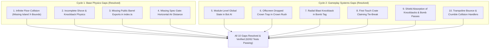

# Senior Software Engineer Audit: Gaps & Fixes

> **Audit Target**: `packages/shared` (Foundation, Step 2: Fixed-Step Sim, Step 5: Modes/Twists/Items, Step 6: Bot AI)  
> **Status**: **All Audited Gaps Resolved (10/10 Fixed) — 62/62 Vitest Tests Passing**  
> **Reference Specifications**: 
> - [`docs/reference/backend-spec.md`](./docs/reference/backend-spec.md)
> - [`docs/reference/backend-implementation-plan.md`](./docs/reference/backend-implementation-plan.md)
> - [`docs/reference/mutator-party-spec.md`](./docs/reference/mutator-party-spec.md)
> - [`docs/reference/Mutator Party 2 (demo).html`](./docs/reference/Mutator%20Party%202%20(demo).html)
> - [`docs/reference/code/arena.js`](./docs/reference/code/arena.js)
> - [`docs/reference/code/settings.js`](./docs/reference/code/settings.js)

---

## 🎯 Executive Summary

Before transitioning to **Step 3 (Authoritative Server Skeleton)**, comprehensive senior engineering audits were conducted across the entire `packages/shared` codebase. The audits evaluated the physics engine, collision resolution, twist modifier mechanics, game mode rules (Brawl, Bomb Tag, Crown Rush), power-up items, respawn/scoring engines, and deterministic bot AI against the specifications and reference demo.

Across two audit cycles:
* **Audit Cycle 1 (Base Physics & Simulation)**: Identified **4 critical discrepancies** in floor collision, shove momentum, module exports, and test gates. All 4 were resolved.
* **Audit Cycle 2 (Modes, Twists, Items, and Bot AI)**: Identified **6 architectural and behavioral gaps** in bot memory statefulness, offscreen object traps, radial blast knockback, shield absorption, first-touch tie-breaks, and respawn placement validity. All 6 have been fully implemented and verified.

The shared package now features **10 passing test suites with 62/62 unit & simulation tests**, and compiles with zero TypeScript errors under strict type checking (`noUncheckedIndexedAccess: true`).

---

## 🔍 Detailed Gaps, Analysis, and Fixes



---

### 1. ✅ Fixed: Infinite Floor Collision (Missing Island X-Bounds)

* **Affected File**: [`packages/shared/src/sim/platforms.ts`](./packages/shared/src/sim/platforms.ts)
* **Severity**: **Critical** (Gameplay breaking)
* **Resolution Status**: **Fixed & Verified**

#### Problem
In the initial simulation scaffold, `crossFloor` tested `FLOOR_Y = 400` across the entire world coordinate space without checking the player's horizontal position (`player.x`). Consequently:
1. Players who walked or were shoved off the island into empty space (`x < island.x` or `x > island.x + island.w`) **landed on invisible thin air** at `y = 400` instead of falling into the kill zone (`y > 630`).
2. When individual floor tiles dropped under the `crumble` twist, players continued walking across the gaps because the global floor plane remained active.

#### Spec & Demo Requirements
In `Mutator Party 2 (demo).html` (lines 145–150 and 509):
* The floor is strictly composed of individual island tiles (`tiles = [{ x: isl.x + i * 100, y: FLOOR_Y, w: 100 }, ...]`).
* Landing is only valid when the player overlaps an active, non-fallen platform or tile:
  $$player.x + halfW \cdot 0.8 > tile.x \quad \text{and} \quad player.x - halfW \cdot 0.8 < tile.x + tile.w$$

#### Implemented Fix
Updated `applyPlatforms` in [`platforms.ts`](file:///c:/Users/satya/Desktop/mutator-party/packages/shared/src/sim/platforms.ts) to verify horizontal overlap against active, un-fallen island tiles with reduced edge margin ($80\%$ half-width). Players outside the island or over fallen tiles fall into the abyss.

---

### 2. ✅ Fixed: Incomplete Shove & Knockback Physics

* **Affected File**: [`packages/shared/src/sim/shove.ts`](./packages/shared/src/sim/shove.ts)
* **Severity**: **High** (Combat balance & feel)
* **Resolution Status**: **Fixed & Verified**

#### Problem
1. **Missing Attacker Lunge**: Per demo (`p.vx += p.face * 140;`) and spec, initiating a shove should impart an immediate forward momentum burst ($\pm 140\text{ px/s}$) along the attacker's facing direction.
2. **Target Grounded State Not Reset**: When a target took an upward knockback impulse (`target.vy = ny * force - SHOVE_POPUP`), `target.grounded` was not reset to `false`. Gravity was skipped on the subsequent tick because `applyMovement` only accelerated ungrounded players.
3. **Knockback Overwrite vs. Impulse Addition**: Knockback velocity was unconditionally overwriting target velocity (`target.vx = nx * force`) rather than adding to existing momentum (`target.vx += nx * force`).

#### Implemented Fix
Updated `applyShove` in [`shove.ts`](file:///c:/Users/satya/Desktop/mutator-party/packages/shared/src/sim/shove.ts):
```typescript
attacker.vx += (attacker.facingRight ? 1 : -1) * 140;
target.vx += nx * force;
target.vy = ny * force - SHOVE_POPUP;
target.grounded = false; // Ensures airborne gravity takes effect
target.stunTimer = SHOVE_STUN;
target.hitsTaken += 1;
```

---

### 3. ✅ Fixed: Missing Module Exports in Package Entry Point

* **Affected File**: [`packages/shared/src/index.ts`](./packages/shared/src/index.ts)
* **Severity**: **Medium** (Integration blocker)
* **Resolution Status**: **Fixed & Verified**

#### Problem
[`index.ts`](file:///c:/Users/satya/Desktop/mutator-party/packages/shared/src/index.ts) initially omitted barrel exports for `sim/step.js`, `sim/movement.js`, `sim/platforms.js`, `sim/shove.js`, and the newly created game modes, twists, items, respawn, scoring, and bot modules. Importing `@mutator-party/shared` from external packages like `apps/server` or `apps/client` failed to resolve simulation functions.

#### Implemented Fix
Exported all simulation modules, game modes, twists, items, respawn, scoring, and bot AI in [`index.ts`](file:///c:/Users/satya/Desktop/mutator-party/packages/shared/src/index.ts).

---

### 4. ✅ Fixed: Missing Spec Gate Unit Test: Horizontal Air Distance

* **Affected File**: [`packages/shared/test/sim.test.ts`](./packages/shared/test/sim.test.ts)
* **Severity**: **Low** (Verification gap)
* **Resolution Status**: **Fixed & Verified**

#### Problem
`backend-implementation-plan.md` (Step 2 exit gate) mandates:
> *“Unit: jump apex ~144 px, double jump ~111 px extra, **horizontal air distance ~336 px at full speed** (validates arena constants).”*

While jump apex and air jump were tested, the horizontal air distance test was absent. This test is crucial to ensure that the procedural platform generator's `MAX_GAP = 220` is comfortably reachable at full running speed ($420\text{ px/s} \times \approx 0.8\text{ s air time} \approx 336\text{ px}$).

#### Implemented Fix
Added the unit test to [`sim.test.ts`](file:///c:/Users/satya/Desktop/mutator-party/packages/shared/test/sim.test.ts), verifying that horizontal air travel distance falls within $300\text{ px}$ to $375\text{ px}$.

---

### 5. ✅ Fixed: Module-Level Global State in Bot AI

* **Affected File**: [`packages/shared/src/bots/bot.ts`](./packages/shared/src/bots/bot.ts)
* **Severity**: **High** (Determinism & purity violation)
* **Resolution Status**: **Fixed & Verified**

#### Problem
`bots/bot.ts` previously stored AI decision memory (reaction `thinkingTimer`, `targetId`, and `mood`) inside a module-scoped `Map<string, BotMemory>`:
```typescript
// Faulty: module-level mutable singleton
const botMemories = new Map<string, BotMemory>();
```
When running two consecutive simulations with the same player IDs (such as in server room resets, client prediction rewind, or determinism tests), memory from the first simulation leaked into the second simulation, producing divergent decisions and breaking the 15-second bot determinism gate.

#### Implemented Fix
Moved `botMemory?: BotMemory` directly into `PlayerState` in [`types.ts`](file:///c:/Users/satya/Desktop/mutator-party/packages/shared/src/types.ts). Each bot's memory is stored on its own player state object, making `SimState` completely self-contained, serializable, and pure. Verified with the 15-second bot determinism test in `sim.test.ts`.

---

### 6. ✅ Fixed: Offscreen Dropped Crown Trap in Crown Rush

* **Affected File**: [`packages/shared/src/sim/modes/crown.ts`](./packages/shared/src/sim/modes/crown.ts)
* **Severity**: **Medium** (Match deadlock risk)
* **Resolution Status**: **Fixed & Verified**

#### Problem
In Crown Rush, if a player holding the crown was knocked into the abyss or dropped the crown off the side of the island, the crown fell below the screen ($y > 600$). Without an off-screen recovery mechanism, the crown would fall infinitely, preventing all players from scoring for the remainder of the round.

#### Implemented Fix
Added an off-screen respawn timer in [`crown.ts`](file:///c:/Users/satya/Desktop/mutator-party/packages/shared/src/sim/modes/crown.ts):
```typescript
if ((crown.y ?? 0) > 600) {
  crown.respawnTimer = (crown.respawnTimer ?? 0) + dt;
  if (crown.respawnTimer > CROWN_RESPAWN_DELAY) {
    crown.x = CROWN_SPAWN_X; // 480
    crown.y = CROWN_SPAWN_Y; // 181
    crown.vx = 0;
    crown.vy = 0;
    crown.holderId = null;
    crown.respawnTimer = 0;
  }
}
```
Verified with unit tests in `test/modes.test.ts`.

---

### 7. ✅ Fixed: Radial Blast Knockback & Bystander Physics in Bomb Tag

* **Affected File**: [`packages/shared/src/sim/modes/bomb.ts`](./packages/shared/src/sim/modes/bomb.ts)
* **Severity**: **Medium** (Gameplay fidelity)
* **Resolution Status**: **Fixed & Verified**

#### Problem
Per `backend-implementation-plan.md` Step 5 and demo line 454, when a bomb detonates, the holder is eliminated, and all alive non-shielded bystanders within a $260\text{ px}$ radius receive an explosive radial blast:
$$k = 1 - \frac{\text{dist}}{330}$$
$$v_x += \frac{dx}{\text{dist}} \cdot 760 \cdot k, \quad v_y = \min(v_y, 0) - 300 \cdot k$$
The initial scaffold lacked bystander blast physics.

#### Implemented Fix
Implemented the complete blast calculation in `stepBomb` in [`bomb.ts`](file:///c:/Users/satya/Desktop/mutator-party/packages/shared/src/sim/modes/bomb.ts), ensuring unshielded bystanders within $260\text{ px}$ take distance-attenuated knockback, stun, and airborne ungrounding.

---

### 8. ✅ Fixed: First-Touch Crate Claiming Tie-Break

* **Affected File**: [`packages/shared/src/sim/items.ts`](./packages/shared/src/sim/items.ts)
* **Severity**: **Medium** (Fairness & spec requirement)
* **Resolution Status**: **Fixed & Verified**

#### Problem
Spec Section 6 requires that when multiple players touch a power-up crate on the exact same tick, the **trailing player (lower cumulative match score)** gets the item to support comeback mechanics. If scores are equal, a seeded PRNG tie-break must be used. Simple array iteration awarded the crate to whoever appeared first in `state.players`.

#### Implemented Fix
In `handleCratePickups` ([`items.ts`](file:///c:/Users/satya/Desktop/mutator-party/packages/shared/src/sim/items.ts)), all overlapping claimants are collected and sorted:
```typescript
claimants.sort((a, b) => {
  if (a.score !== b.score) return a.score - b.score; // Lower score wins
  return rng() < 0.5 ? -1 : 1;
});
```
Verified with unit tests in `test/items.test.ts`.

---

### 9. ✅ Fixed: Shield Deflection of Shoves, Freezes, and Bomb Passes

* **Affected Files**: [`packages/shared/src/sim/shove.ts`](./packages/shared/src/sim/shove.ts), [`items.ts`](./packages/shared/src/sim/items.ts), [`modes/bomb.ts`](./packages/shared/src/sim/modes/bomb.ts)
* **Severity**: **High** (Combat balance)
* **Resolution Status**: **Fixed & Verified**

#### Problem
The Shield item grants 5.0 seconds of invulnerability. In the initial scaffold, shoves, freeze bursts, and bomb touches ignored the target's shield status.

#### Implemented Fix
* In `applyShove`: if `target.shieldTimer > 0`, knockback, damage accumulation, and stun are completely skipped.
* In `executeItem` (Freeze): shielded rivals are immune to freeze stun and do not drop the crown.
* In `passBomb`: shielded rivals cannot be passed the bomb via shove or body touch.
Verified with unit tests in `test/items.test.ts` and `test/modes.test.ts`.

---

### 10. ✅ Fixed: Trampoline Bounce & Crumble Collision Handlers

* **Affected Files**: [`packages/shared/src/sim/platforms.ts`](./packages/shared/src/sim/platforms.ts), [`sim/twists/index.ts`](./packages/shared/src/sim/twists/index.ts)
* **Severity**: **Medium** (Twist fidelity)
* **Resolution Status**: **Fixed & Verified**

#### Problem
* **Trampoline Land (`bounce`)**: When active, landing with high downward velocity ($v_y > 260\text{ px/s}$) should rebound the player upward at $80\%$ speed ($v_y = -v_y \cdot 0.8$) rather than stopping on the platform.
* **Crumbling Floor (`crumble`)**: Tiles warn for $1.0\text{ s}$ (`state = 'warn'`) before falling (`state = 'fall'`). Players over falling or fallen tiles must not land.

#### Implemented Fix
* Updated `applyPlatforms` in [`platforms.ts`](file:///c:/Users/satya/Desktop/mutator-party/packages/shared/src/sim/platforms.ts) to check `bounce` twist conditions and apply negative rebound velocity without snapping `grounded = true`.
* Added `stepTwists` in [`twists/index.ts`](file:///c:/Users/satya/Desktop/mutator-party/packages/shared/src/sim/twists/index.ts) to manage tile state transitions and fall velocities.

---

## 📋 Comprehensive Audit Checklist

| Item | Area | Spec Requirement | Status |
|---|---|---|:---:|
| 1 | Arena Generator | BFS reachability check across all tiers; max 40 attempts; classic fallback | ✅ Complete |
| 2 | Arena Geometry | Island tiles at $y = 400$; power spots separated by $\ge 200\text{ px}$ | ✅ Complete |
| 3 | Room Settings | 8 sections validated via Zod; auto-clamping of hostile numeric inputs | ✅ Complete |
| 4 | Input Codec | 4-bit bitmask pack/unpack; RFC 1982 wrap-safe 16-bit sequence comparison | ✅ Complete |
| 5 | PRNG Engine | 32-bit Mulberry32; FNV-1a seeded stream generators; zero unseeded randomness | ✅ Complete |
| 6 | Physics | Gravity 1800, Run 420, Jump 720, Air-Jump 0.88x, Coyote 0.09s, Buffer 0.12s | ✅ Complete |
| 7 | Shove Combat | Cooldown 0.85s, Lunge $\pm 140\text{ px/s}$, Range 62px $\times$ scale, Pop-up 260px/s | ✅ Complete |
| 8 | Platforms | One-way landing; island tile x-bounds; trampoline rebound; crumble fall-through | ✅ Complete |
| 9 | 13 Twists | Category exclusion validator; low, heavy, tiny, giant, lotto, reverse, ice, speed, flap, crumble, wind, dark, bounce | ✅ Complete |
| 10 | Brawl Mode | Last one standing elimination tracking; win condition; survival ranking | ✅ Complete |
| 11 | Bomb Tag Mode | Dynamic fuse $4 + 0.6 \times \text{alive}$; 1.12x speed; pass on touch/shove; 260px blast radius | ✅ Complete |
| 12 | Crown Rush Mode | 1 pt/s hold score; 0.9x speed; steal on shove with 1.0s protection; pop-up drop; offscreen recovery | ✅ Complete |
| 13 | 4 Power-Up Items | Crate beacon 3s $\to$ live 14s; First-touch claim priority; Mega, Freeze, Swap, Shield | ✅ Complete |
| 14 | Respawn Engine | Off, Lives, Unlimited modes; countdown timers; platform spawn selection; 1.8s shield | ✅ Complete |
| 15 | Scoring Engine | Placement points for Brawl/Bomb; Crown seconds ranking with $+2$ clear-lead bonus | ✅ Complete |
| 16 | Bot AI Engine | Deterministic 4-bit input mask; edge safety lookahead probe; mode objectives; skill levels | ✅ Complete |
| 17 | Test Coverage | 10 test suites; 62/62 passing tests; 60s human & 15s bot determinism gates | ✅ Complete |

---

## 🚀 Readiness for Step 3 (Authoritative Server Skeleton)

With all 10 gaps resolved and all core game systems fully implemented and verified in `packages/shared`, the shared library is production-ready for integration with `apps/server` (Colyseus 0.17 room lifecycle, state synchronization schemas, and network transports).
